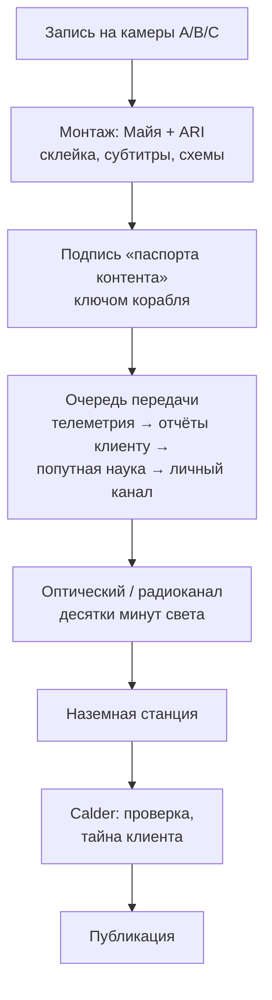

# Медиа и зрители

Кратко: влог Майи внутри мира — дневник сервисного оператора вычислительного корабля. Зачем она его ведёт, что ей можно показывать, как ролик проходит десятки минут светового пути до Земли, кто его смотрит и как вопросы зрителей возвращаются на борт. Рекомендуемая версия: влог личный, но разрешён контрактом и поддержан Calder Deep Space. Внутри мира он называется так же, как сериал, — **Maya in Transit**.

## Из исходников

- Питч: молодая женщина одна путешествует по Солнечной системе в 2050-х и непринуждённо ведёт влог о миссии изнутри физически согласованного корабля (CONCEPT, «One-line pitch»).
- Первое впечатление: «this woman has been living here for a while, and we have just discovered her vlog» (CONCEPT, «Core principle»).
- Камера C — «answering viewer questions», то есть вопросы зрителей до неё доходят (CONCEPT, «Main camera setups»).
- В эпизоде 6 она «answers a message» ([быт](../40-characters/maya-daily-life.md)).
- В статусной строке есть «communications delay» (SPEC §6). Среди экранных шаблонов — «communications message» и «simplified "viewer explanation" diagram» (SPEC §36). Корабль, выходит, умеет рисовать объяснения для зрителей.
- Формат — короткие вертикальные ролики 30–60 секунд (CONCEPT, «Episode formula»; [формат](../70-series/format.md)).

## Как влог связан с работой

> [!fiction] Вымысел
> Рекомендуемый вариант развилки; альтернативы — в «Открытых вопросах». Рамка — решения D-012 и D-015.

- **Личный, но разрешённый.** Влог — пункт контракта Майи с Calder. Майя сама решает, что снимать и как говорить. Связи с общественностью Calder публикуют ролики и не правят тон ([организации](organizations.md#связи-с-общественностью-calder)).
- **Тайна клиента.** Операции, данные и машины EDC принадлежат клиенту ([вычислительная вахта](../20-mission/compute-service.md)). Майя может сказать, что сегодня была стыковка, но не может показать экран с её параметрами без разрешения EDC. Отсюда внутримировая причина, почему влог больше о дороге, Юпитере, быте и попутной науке, чем о самой работе.
- **Лёгкая проверка.** Перед публикацией ролик проходит автоматический фильтр и беглый просмотр человеком. Проверяют четыре вещи: тайну клиента, экспортно-контролируемые подробности реактора и двигателей, чужие персональные данные и медицинскую тайну. Обычно это занимает меньше суток.
- **История канала.** Майя завела канал ещё на Земле, перед отлётом. В перелёте он молчал: час бодрствования в сутки уходил на еду, тренировку и учёбу ([технологии эпохи](technology-2050s.md#активный-сон-на-уровне-мира)). Канал вернулся уже из системы Юпитера, когда Майя давно жила в обычном режиме: «Okay. I should probably explain where I am.» Зритель сериала «находит» влог именно в этот момент.

## Зачем Майя это делает

> [!fiction] Вымысел

1. Это дневник для неё самой и для семьи: что было сегодня на работе, которую дома трудно представить.
2. Calder это выгодно. Влог — человеческое лицо первого вычислительного корабля и лучшая реклама профессии: следующим кораблям понадобятся операторы. После [V-инцидента](v-incident/index.md) людям к тому же важно видеть, как выглядит человек в контуре управления ИИ вдали от Земли. Влог показывает это без пафоса: женщина в шортах читает запрос ARI и решает ([закон](human-authority-law.md)).
3. Ей нравится объяснять. Наука «происходит вокруг», и рассказывать о ней естественно (CONCEPT, «Scientific philosophy»). Материал дают попутные задачи и моменты, когда она говорит ARI «стоп, объясни» перед тем, как подтвердить. Понять, прежде чем подписать, — её работа, а пересказать понятое зрителям — следующий шаг ([Майя](../40-characters/maya.md)).
4. Это помогает жить одной: ритм, разговор, ощущение, что тебя слышат. Это прямое следствие четвёртой причины существования вещей на корабле — «make long isolation psychologically tolerable» (SPEC §41).

## Как ролик доходит до Земли

> [!fiction] Вымысел
> Канал связи, окна и задержка — [связь с Землёй](../20-mission/earth-link.md) и [связь корабля](../30-ship/systems/communications.md); расстояния — [расстояния и задержка сигнала](../50-science/distances-and-light-time.md).

- **Приоритеты канала.** Телеметрия, отчёты клиенту и попутная наука идут первыми. Влог и личная почта пользуются небольшой выделенной долей. Это внутримировое объяснение коротких роликов: полоса у Юпитера ограничена и делится с работой.
- **Ритм.** Ролик выходит через часы или дни после записи. Прямых эфиров нет и быть не может.
- **Обратная связь.** Комментарии Майя не видит в реальном времени. Связи с общественностью Calder раз в несколько дней отбирают вопросы зрителей и отправляют их пакетом. Майя отвечает на некоторые из них на камеру C.
- **Объясняющие схемы.** Схемы для зрителей рисует ARI на экранах корабля (шаблон «viewer explanation», SPEC §36; [экранные шаблоны](../70-series/screen-templates.md)).

## Кто смотрит

> [!fiction] Вымысел

- **Ровесники.** Люди её поколения в таких же комнатах на девять квадратных метров ([Земля в 2050-х](earth-2050s.md#работа-и-деньги)). Для них Майя — та, кто вырвался. О деньгах она не говорит, но они и так всё понимают.
- **Космос:** люди, которым интересен космос, — студенты, инженеры, школьные классы.
- **Коллеги:** операторы человеческого контроля на Земле, которые весь день подтверждают решения ИИ в энергосетях, логистике, медицине. Для них Майя — «одна из нас, только у Юпитера». Шутка про «жать Enter» — их общая шутка. Кто-то из них смотрит влог как объявление о вакансии.
- **«Для компании»:** люди, которые смотрят Майю как спокойный фоновый контент. Она пьёт кофе, за окном растёт Юпитер. Ценность — в нормальности.
- **Скептики:** «это всё рендер». Над этим смеётся и сама Майя: «Every time I zoom in, my brain keeps telling me this is a render.»
- **Дома:** семья, друзья, город, где она выросла ([предыстория](../40-characters/maya-backstory.md)).
- Аудитория мировая. Майя говорит по-английски; дубляж и субтитры на другие языки делает автоматика платформ. Испаноязычные зрители иногда слышат её родной испанский — в сообщениях семье, если она решает их показать.

## Подлинность в эпоху синтетики

> [!fiction] Вымысел

- Синтетического видео в 2050-х так много, что проверяемое происхождение стало ценностью само по себе ([Земля](earth-2050s.md)).
- Каждый файл подписан аппаратным ключом корабля и несёт «паспорт контента» (Content Credentials) — потомок открытого стандарта C2PA 2020-х. Наземная станция добавляет метку времени приёма. Задержка между записью и приёмом сходится со световым временем до Юпитера, и проверить это может любой.
- Любители с большими антеннами ловят несущую корабля, как ловят сигналы далёких автоматических аппаратов. Это ещё одна независимая проверка.

## Что раскрыть при углублении

- Доля полосы на влог и личную связь — после расчёта канала ([связь корабля](../30-ship/systems/communications.md)).
- Правила проверки: что именно вырезают и были ли случаи.
- Как Майя монтирует: сколько времени уходит в неделю, что делает ARI ([быт](../40-characters/maya-daily-life.md)).
- Ритм публикаций в сезоне 1 и его связь с туром — только если пользователь решит развивать [сериал](../70-series/index.md).
- Как выглядит «страница канала» внутри мира — понадобится ли когда-нибудь в кадре.

## Связи

- [Связь с Землёй](../20-mission/earth-link.md) — задержка, окна связи, как уходит влог.
- [Концепция сериала](../70-series/series-concept.md) — сериал и есть этот влог; тон задан там.
- [Формат и формула эпизода](../70-series/format.md) — почему ролики короткие.
- [Камеры](../70-series/cameras.md) и [внутренние камеры](../30-ship/habitat/interior-cameras.md) — на что снимается влог.
- [ARI](../40-characters/ari.md) — соавтор монтажа и схем.
- [Организации](organizations.md) — связи с общественностью Calder и тайна клиента EDC.
- [Вычислительная вахта](../20-mission/compute-service.md) — работа, о которой влог рассказывает в общих словах.
- [Земля в 2050-х](earth-2050s.md) — откуда смотрят зрители и почему им понятна Майя.
- [Закон о человеческом контроле](human-authority-law.md) — почему публике важно видеть человека в контуре.

## Основания

> [!verified] Проверено
> - C2PA — открытый технический стандарт, позволяющий издателям, авторам и зрителям устанавливать происхождение цифрового контента и историю его правок. Реализация — Content Credentials, «как этикетка состава для цифрового контента». https://c2pa.org/
> - Эксперимент DSOC передал видео сверхвысокой чёткости с расстояния около 31 млн км (11 декабря 2023), пиковая скорость — 267 Мбит/с. https://www.jpl.nasa.gov/missions/dsoc/

> [!fiction] Вымысел
> Внутримировой влог, его название, правила публикации, тайна клиента, аудитория и «паспорт контента» корабля выдуманы. Роль Майи — D-012, мотивация зрителей-ровесников — D-015.

> [!production] Решение для производства
> Механика доставки ролика в кадре не показывается. Видимые следы: задержка связи в статусной строке, экран входящего сообщения, ответы на вопросы зрителей на камеру C. Тема подлинности — только в репликах, и то редко: сериал сам по себе рендер, и шутка не должна стать главной.

## Открытые вопросы

- **Как влог связан с работой.** Рекомендую «личный, разрешённый контрактом Calder, с лёгкой проверкой». Альтернативы: (а) официальный канал Calder, где Майя ведущая: глаже, но теряется интимность дневника и влог становится рекламой; (б) контракт с медиаплатформой, которая купила права: правдоподобно коммерчески, но влог начинает выглядеть продуктом.
- **Деньги с влога.** Зарабатывает ли Майя на канале? Рекомендую нет: контракт запрещает рекламу, следующая лига — это зарплата за вахту. Так влог остаётся дневником, а не вторым заработком.
- **Сколько тайны клиента в кадре.** Рекомендую: машины EDC видны на экранах и в окне, параметры операций и данные — никогда. Решает [вычислительная вахта](../20-mission/compute-service.md).
- Название канала внутри мира = название сериала («Maya in Transit»)? Рекомендую да. Альтернатива — канал называется просто её именем, а «Maya in Transit» существует только вне мира.
- Видела ли Майя реакцию зрителей на первый ролик после возвращения канала? Это хороший момент для эпизода «ответы на вопросы», но решать — в [сериале](../70-series/index.md).
