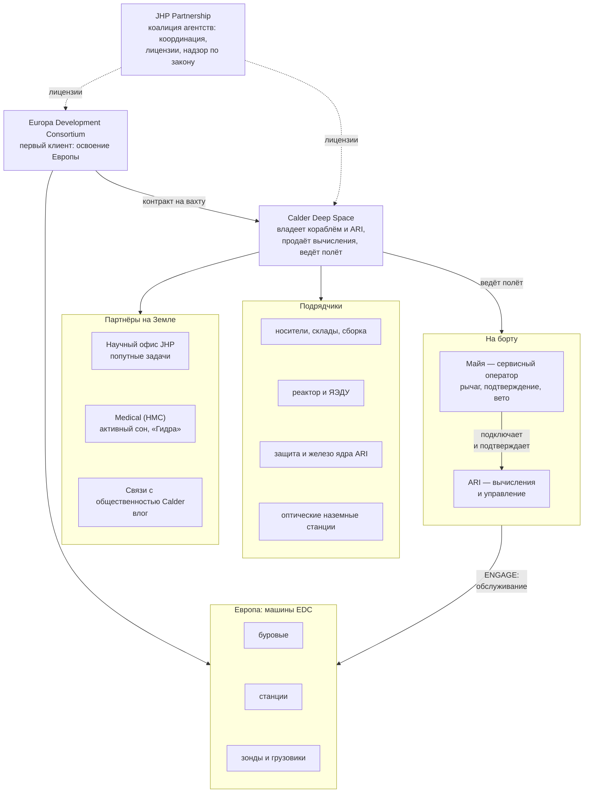

# Организации

Кратко: кто владеет кораблём, кто за него платит и кто разрешает ему работать. Корабль и ARI принадлежат **Calder Deep Space**: компания продаёт вычисления как услугу там, куда сигнал с Земли идёт слишком долго. Первый клиент — **Europa Development Consortium (EDC)**, который осваивает Европу машинами. Коалиция агентств **JHP Partnership** координирует работы в системе Юпитера, выдаёт лицензии и следит за соблюдением [закона о человеческом контроле](human-authority-law.md). Майя — сотрудница Calder, сервисный оператор.

> [!fiction] Вымысел
> Все названия на странице рабочие. Схема следует решению D-012 ([журнал решений](../90-reference/decisions.md)): корабль — передвижной вычислительный узел, работа идёт вахтами, первая точка — Европа. В исходниках организаций нет совсем.

## Схема

## Как автономная миссия стала вычислительной вахтой

> [!fiction] Вымысел
> Рекомендуемая версия; годы — относительно отлёта D, на шкале [хронологии](timeline.md).

1. **Начало 2040-х.** Агентства коалиции заказывают Calder автономный исследовательский корабль к Юпитеру: реактор, электрические двигатели и ИИ класса ARI, который сам ведёт тур и сам планирует наблюдения. Людей на борту не предполагалось. Calder вкладывает в реактор и ARI собственный капитал: ставка на то, что такой корабль пригодится не один раз.
2. **Середина 2040-х.** [V-инцидент](v-incident/index.md), затем [закон о человеческом контроле](human-authority-law.md): адаптивный ИИ вдали от людей не может сам решать необратимое. С Земли подтверждать нельзя: сигнал идёт ≈33–54 мин в одну сторону. Отказаться от ARI — значит свести миссию к повторению Europa Clipper.
3. **Вторая половина 2040-х.** Корабль перепроектируют под человека: жилой модуль на ферме, вращение, укрытие. Программа получает слово «Human» в названии — Jovian Human Pathfinder. Цена растёт, и в бюджетных комитетах звучит неудобный вопрос: зачем везти человека к Юпитеру ради науки, которую автоматы делают дешевле? Научный бюджет режут.
4. **Те же годы.** У Европы начинается освоение машинами, и его ведёт EDC ([космическая отрасль](space-industry.md#освоение-европы)). Машины работают по закону: простая автоматика и утверждённые с Земли последовательности команд. Каждая сложная операция — стыковка, посадка, проход бура через трудный слой — растягивается на дни переписки с Землёй. Узкое место — не железо, а мозг рядом и человек при нём.
5. **Разворот (≈ D − 5).** Calder предлагает EDC то, что у неё уже почти построено: корабль с реактором, защищённым дата-центром и сертифицированным ИИ, плюс человек в контуре. Это единственное место у Юпитера, где ИИ выше порога может законно работать с машинами в реальном времени. EDC покупает первую вахту. Агентства превращают офис программы в координатора системы Юпитера — JHP Partnership. Наука уходит в попутные задачи: агентства покупают у Calder часы ARI и наблюдения по пути.

Итог: корабль, построенный под исследователя, стал первым вычислительным кораблём дальнего космоса ([вычислительная вахта](../20-mission/compute-service.md)). В отрасли шутят, что из полного названия программы правдой осталось одно слово — Human.

## Участники

### Calder Deep Space — владелец и оператор
Коммерческая компания. Спроектировала и построила корабль, владеет им и ARI, ведёт полёт и продаёт вычисления на месте (compute on site): часы ARI для задач клиента, сопровождение операций, пилотирование чужих машин. Название — от скульптора Александра Колдера, автора кинетических «мобилей», уравновешенных вращающихся конструкций. Это внутренняя шутка инженеров про «гантель» корабля ([архитектура](../30-ship/ship-architecture.md)).

- **Ставка.** Это первый вычислительный корабль класса. Если первая вахта окупится, за ним последуют следующие, а сам корабль пойдёт от точки к точке ([дальнейшие этапы](../20-mission/future-arcs.md)).
- **Центр управления** — Calder Mission Operations ([люди на Земле](../40-characters/mission-control.md)). В контур он не входит: планирует, ведёт переговоры с клиентом, проверяет журнал.
- **ARI** создало и сопровождает подразделение автономных систем Calder. Фундаментальную модель лицензировали у одной из крупных ИИ-компаний, лётную версию Calder дообучила и сертифицировала сама ([ARI](../40-characters/ari.md), [ядро ARI](../30-ship/systems/ari-core.md)).
- **Майя** — сотрудница Calder, сервисный оператор на контракте на весь рейс. Для неё это выход в следующую лигу (D-015; [предыстория](../40-characters/maya-backstory.md)).

### Europa Development Consortium (EDC) — первый клиент
Консорциум компаний — бурение, робототехника, энергетика, связь — и научных подразделений нескольких агентств. Цель — открыть доступ к океану Европы: машины проходят ледяную кору, ставят станции на поверхности и ретрансляторы на орбите. Потом консорциум продаёт доступ: места на станциях, время буров, каналы данных — агентствам и институтам, которым нужен океан ([Европа](../50-science/europa.md)).

- **Что покупает у Calder.** Вахту у Европы: расчёты по заказу (модели льда, навигация зондов в скважине, обработка данных), сопровождение стыковок грузов и посадок, ключевые фазы бурения, ведение машин в трудные моменты ([вычислительная вахта](../20-mission/compute-service.md)).
- **Как работает с кораблём.** Операторы EDC на Земле планируют кампании и дают своим машинам постоянные приказы. В реальном времени у Европы их машинами занимаются ARI и Майя, когда рычаг в `ENGAGE` ([рычаг подключения](../30-ship/systems/engage-lever.md)).
- **Тайна клиента.** Данные и подробности операций принадлежат EDC. Это ограничивает, что Майя может показать во влоге ([медиа](media-and-audience.md)).

### JHP Partnership — координатор и лицензиар
Коалиция космических агентств из круга участников Соглашений Артемиды. Выросла из офиса программы Jovian Human Pathfinder и сохранила сокращение. Юридически — соглашение по образцу МКС: доли участников, общий совет, общие правила.

- **Координирует систему Юпитера:** кто где и когда работает, орбиты, места посадок, частоты, движение. Похоже на диспетчерскую порта.
- **Выдаёт лицензии:** на операции (EDC), на вахты (Calder), допуски сервисных операторов к конкретной вахте. Операции класса V к вахтам не допускаются ([закон](human-authority-law.md#классы-действий)).
- **Следит за законом.** Национальные регуляторы далеко, поэтому журналы подтверждений и подключений в системе Юпитера читает и разбирает JHP. В контур она не входит.
- **Планетарная защита.** Машины, которые касаются льда и океана Европы, стерилизуют по правилам JHP. Это продолжение реальной практики: аппараты к Европе относятся к самым строгим категориям.
- Деньги JHP — взносы агентств и лицензионные сборы. За саму вахту платит клиент.

### Научный офис JHP (Science Operations Center, SOC) — попутные задачи
Когда-то научный центр исследовательской миссии, теперь — заказчик попутных задач. Собирает заявки учёных агентств и EDC — наблюдения по пути, тесты, измерения — и покупает под них часы ARI и время Майи в плане. Миссию наука не ведёт: если попутная задача мешает вахте, она ждёт ([научная программа](../20-mission/science-program.md)).

### Консорциум гипометаболической медицины (Hypometabolic Medicine Consortium, HMC)
Сеть университетских клиник. В 2030-х она делала ставку на глубокий торпор, отсюда имя. Для долгих перелётов в итоге прижился [активный сон](technology-2050s.md#активный-сон-на-уровне-мира), а имя осталось. Сертифицирует протокол сна Майи и костюм «Гидра», ведёт её медицинское сопровождение, даёт врача экипажа на Земле ([стазис](../20-mission/stasis.md)).

### Подрядчики
- **Носители и логистика:** 2–3 оператора тяжёлых носителей, оператор топливного склада, сервис сборки на орбите ([космическая отрасль](space-industry.md)).
- **Реактор и ЯЭДУ:** консорциум национальной лаборатории и промышленности ([реактор](../30-ship/exterior/power-reactor.md)).
- **Защита и железо ядра ARI:** производитель вычислителей и поставщик радиационной защиты дата-центра ([ядро ARI](../30-ship/systems/ari-core.md)).
- **Связь:** радиосеть дальней связи агентств и коммерческие оптические станции ([связь с Землёй](../20-mission/earth-link.md)).

### Регуляторы, страховщики, советы
- Национальный регулятор, лицензирующий запуски и ядерную установку.
- Надзор по закону о человеческом контроле: национальные регуляторы сертифицируют ARI и операторов, JHP выдаёт допуски и разбирает журналы у Юпитера ([закон](human-authority-law.md#надзор)).
- Страховщики Calder и EDC. Риск операций они оценивают и по тому, есть ли у рычага человек.
- Медицинский и этический совет: допуск одиночного полёта, информированное согласие на многолетний активный сон.

### Связи с общественностью Calder
Принимает влог Майи с Земли, проверяет на тайну клиента, экспортный контроль и медицинскую тайну, публикует, собирает вопросы зрителей и раз в несколько дней отправляет их на борт ([медиа и зрители](media-and-audience.md)).

## Кто кому платит

| Кто | Кому | За что |
|---|---|---|
| EDC | Calder | Вахта у Европы: часы ARI, сопровождение операций |
| Агентства через SOC | Calder | Попутные задачи |
| Calder и EDC | JHP | Лицензионные сборы |
| Calder | Майе | Зарплата за рейс и премия за вахту |
| Calder | подрядчикам | Корабль, запуски, реактор, ядро ARI, связь |

## Зачем им это

| Участник | Мотив |
|---|---|
| Calder | Первый вычислительный корабль дальнего космоса; рынок вахт у Юпитера и дальше; возврат вложений в ARI и реактор |
| EDC | Операции, которые через Землю идут днями, у Европы занимают минуты; без мозга рядом часть операций невозможна вовсе |
| Агентства и JHP | Порядок в системе Юпитера; закон работает вдали от Земли; наука попутно и дешевле, чем отдельная миссия |
| HMC | Первый трёхлетний активный сон; данные для медицины Земли |
| Майя | Деньги и выход из комнаты в девять квадратных метров ([Земля в 2050-х](earth-2050s.md#работа-и-деньги)) |
| Общество | Первый человек у Юпитера, которого можно смотреть каждую неделю |

Подробно о целях — [цель миссии](../20-mission/mission-purpose.md).

## Почему экипаж из одного человека

> [!fiction] Вымысел
> Главный довод закреплён решениями D-010 и D-013; остальное — предложение.

1. **Закон и физика.** Подключить ARI к чужим машинам и подтверждать его необратимые действия может только человек на месте. До Земли десятки световых минут, значит, человек должен быть на борту. Один ответственный человек — минимум по закону.
2. **Масса и деньги.** Каждый следующий человек — запасы, объём в радиационном укрытии, больший жилой модуль на конце фермы, ещё одна зарплата. Calder взяла ровно столько людей, сколько требует закон ([архитектура](../30-ship/ship-architecture.md)).
3. **Работа делится честно.** Считает и управляет ARI. Человеку остаются рука на рычаге, ответственность, вето и обслуживание. Второму человеку на борту просто нечего было бы делать.
4. **Активный сон снимает главный довод против одиночества.** Большую часть перелёта Майя спит; полностью бодрствует она на вахте у Юпитера ([стазис](../20-mission/stasis.md)).
5. **Опыт аналогов.** Антарктические зимовки, лунные вахты и одиночные испытания показали, что подобранный человек выдерживает месяцы одиночной работы при регулярной связи.

## Что раскрыть при углублении

- Состав EDC: какие компании и агентства, кто ведёт бурение, кто — станции.
- Внутренняя структура Calder: где штаб, где инженерные центры, сколько людей, строится ли второй корабль.
- Контракт вахты: кто владеет данными и результатами расчётов, что считается сорванной вахтой, кто платит за простой.
- Как JHP разбирает журнал Майи — вместе с [законом](human-authority-law.md).
- Нашивка рейса и обозначение корабля — графика без реальных логотипов.

## Связи

- [Вычислительная вахта](../20-mission/compute-service.md) — что именно Calder продаёт EDC.
- [Закон о человеческом контроле](human-authority-law.md) — почему на борту человек и почему подключение только рукой; JHP — его надзор у Юпитера.
- [Рычаг подключения](../30-ship/systems/engage-lever.md) и [ядро ARI](../30-ship/systems/ari-core.md) — продукт Calder в железе.
- [Цель миссии](../20-mission/mission-purpose.md) — зачем организации запустили рейс.
- [Люди на Земле](../40-characters/mission-control.md) — конкретные люди этих организаций.
- [Космическая отрасль](space-industry.md) — подрядчики, освоение Европы, вычислительные корабли.
- [Хронология](timeline.md) — разворот программы на общей шкале.
- [Технологии эпохи](technology-2050s.md) — активный сон и «Гидра» от HMC.
- [Медиа и зрители](media-and-audience.md) — влог и тайна клиента.
- [ARI](../40-characters/ari.md) — продукт Calder и главный исполнитель вахты.

## Основания

> [!verified] Проверено
> - Соглашения Артемиды — принципы гражданского освоения космоса, учреждены NASA и Госдепартаментом США с семью странами в 2020 году; на октябрь 2026 подписаны 76 странами. https://www.nasa.gov/artemis-accords/
> - NASA заказывает пилотируемые посадочные модули Artemis у коммерческих компаний: Starship HLS (SpaceX) по контракту с NASA; в плане Artemis на 2027 год — проверка одного или обоих коммерческих модулей (SpaceX и Blue Origin). https://www.nasa.gov/reference/human-landing-systems/ , https://www.nasa.gov/humans-in-space/artemis/
> - Планетарная защита NASA: Марс, Европа и Энцелад — три мира с наибольшим научным интересом к возможной внеземной жизни; миссия к ним относится к категории III (пролёт или орбита) или IV (посадка); Europa Clipper — категория III. https://sma.nasa.gov/sma-disciplines/planetary-protection

> [!fiction] Вымысел
> Calder Deep Space, EDC, JHP Partnership, HMC, SOC, история разворота и их отношения выдуманы. В исходниках есть только корабль «MAYA / ARI — SOLO JOVIAN VEHICLE» (SPEC, шапка) и указание, что миссия вымышлена (CONCEPT, «One-line pitch»). Закон и роль человека на борту — D-010; вычислительная вахта и Европа как первая точка — D-012; рычаг — D-013; мотивация Майи — D-015.

> [!production] Решение для производства
> В кадре нет логотипов реальных агентств и компаний. Видимые надписи — обозначения Calder, EDC и JHP.

## Открытые вопросы

- **Расшифровка JHP.** Рекомендую оставить историческое Jovian Human Pathfinder: партнёрство выросло из программы и сохранило имя. Альтернатива — новое имя под новую роль (например, Jovian Harbor Partnership) без истории программы. → [Q-037](../00-open-questions/q-037-jhp-name.md)
- **Разворот или замысел с самого начала.** Рекомендую разворот: корабль задуман исследователем, а работает сервисом — это объясняет, почему у ARI характер учёного и почему на борту есть научные приборы. Альтернатива — Calder с самого начала строила вычислительный корабль, а науки не было вовсе. → [Q-034](../00-open-questions/q-034-converted-or-purpose-built.md)
- **Трудоустройство Майи.** Штатная сотрудница Calder или подрядчица на один рейс с премией в конце? Рекомендую контракт на рейс с крупной выплатой по возвращении: так «следующая лига» ждёт её дома, а не на счету уже сейчас. Решает [предыстория](../40-characters/maya-backstory.md). → [Q-036](../00-open-questions/q-036-maya-returns-home.md)
- **Строится ли второй вычислительный корабль.** Рекомендую «заложен, ждёт итогов первой вахты»: ставка Calder видна, но не гарантирована.
- Называть ли реальные агентства (NASA, ESA, JAXA, CSA) участниками JHP и EDC по имени или заменить их вымышленными?
- Рабочие названия Calder Deep Space, EDC, HMC — подтвердить или заменить. Обозначение корабля: годится ли «Solo Jovian Vehicle» из шапки SPEC как название класса, или нужен класс вычислительных кораблей ([космическая отрасль](space-industry.md#вычислительные-корабли))?
