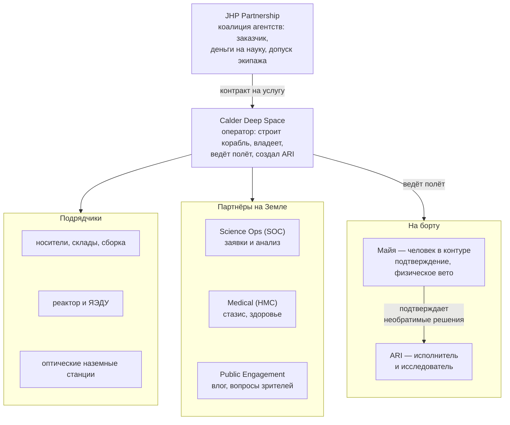

# Организации

Кратко: кто заказал, построил, оплачивает и ведёт миссию Майи. В исходниках организаций нет совсем; эта страница — предложение. Рекомендуемая схема — гибрид: коалиция космических агентств заказывает миссию как услугу, коммерческий оператор строит корабль, владеет им и управляет полётом. Исследования на борту ведёт ARI. Майя по [закону о человеческом контроле](human-authority-law.md) подтверждает его необратимые решения. Наука, медицина и связь — у отдельных партнёров на Земле.

> [!fiction] Вымысел
> Все названия на странице — рабочие. Схема — рекомендуемый вариант развилки «кто заказывает и финансирует миссию»; альтернативы — в «Открытых вопросах». Роль ARI и человека на борту закреплена решением D-010 ([журнал решений](../90-reference/decisions.md)).

## Схема

## История программы

> [!fiction] Вымысел
> Рекомендуемая версия; хронология — [хронология](timeline.md).

1. **Начало 2040-х.** JHP задумана как автономная исследовательская миссия: большой корабль с ЯЭДУ и ИИ класса ARI, который сам ведёт тур по системе Юпитера и сам планирует наблюдения. Людей на борту не предполагалось.
2. **Середина 2040-х.** [V-инцидент](v-incident/index.md), затем [закон о человеческом контроле](human-authority-law.md): необратимые и опасные действия ИИ — включения двигателей, режимы реактора, выпуск зондов, смена плана миссии — утверждает человек, находящийся в контуре управления в реальном времени (задержка — секунды).
3. **Тупик.** До Земли 33–54 минуты света в одну сторону. Подтверждать решения ARI с Земли закон не позволяет. Отказаться от ARI нельзя: без адаптивного ИИ миссия свелась бы к повторению Europa Clipper.
4. **Решение.** На борт добавлен один человек — минимум по закону. Стазис с марсианских перелётов делает это посильным: человеку не нужно бодрствовать весь перелёт. Корабль получает жилой модуль на ферме, вращение и укрытие. Программа переименована: «Human» в названии JHP появилось именно тогда.

Ирония, которую понимают все участники: корабль построен вокруг ARI, а жилой модуль — цена закона.

## Участники

### Программа JHP — заказчик
**Jovian Human Pathfinder** («пилотируемый разведчик системы Юпитера») — межправительственная программа нескольких космических агентств из круга участников Соглашений Артемиды. Юридически — соглашение по образцу МКС: доли участников, распределение научных данных, общий совет по безопасности.

- Платит основную часть стоимости миссии — как за услугу, по образцу коммерческих контрактов 2010–2020-х (грузы и экипажи к МКС, лунные посадочные модули).
- Утверждает научную программу и экипаж; держит медицинский и этический допуск.
- Офис программы (JHP Program Office) — небольшая межагентская команда.

### Calder Deep Space — оператор и строитель
Коммерческая компания, которая спроектировала и построила корабль, владеет им и ведёт полёт по контракту с JHP. Название — от скульптора Александра Колдера, автора кинетических «мобилей», уравновешенных вращающихся конструкций. Это внутренняя шутка инженеров про «гантель» корабля ([архитектура](../30-ship/ship-architecture.md)).

- Вложила в корабль собственный капитал: ставка на то, что это первый аппарат класса и за ним последуют заказы — исследовательские рейсы во внешнюю систему с ИИ и человеком в контуре, марсианские корабли со стазисом.
- Центр управления полётом — **Calder Mission Operations** ([люди на Земле](../40-characters/mission-control.md)).
- Подразделение автономных систем создало и сопровождает [ARI](../40-characters/ari.md) — один из первых ИИ дальнего космоса, сертифицированных по закону о человеческом контроле.
- Майя — сотрудница Calder, прикомандированная к JHP как оператор человеческого контроля ([предыстория](../40-characters/maya-backstory.md)).

### Научный центр JHP (Science Operations Center, SOC)
Международная научная команда университетов и институтов агентств. Формирует научные цели и заявки, принимает и анализирует данные ([научная программа](../20-mission/science-program.md)). На борту наблюдения планирует и ведёт ARI: SOC задаёт «что», ARI решает «как и когда» в рамках [тура](../20-mission/jovian-tour.md). Необратимые шаги вроде выпуска зонда ARI выполняет только после подтверждения Майи ([научные приборы](../30-ship/systems/science-instruments.md)).

### Консорциум гипометаболической медицины (Hypometabolic Medicine Consortium, HMC)
Сеть университетских клиник, которая в 2030–2040-х провела клинические испытания стазиса. Сертифицирует протокол, ведёт медицинское сопровождение Майи, поставляет врача экипажа ([стазис](../20-mission/stasis.md), [технологии](technology-2050s.md)).

### Подрядчики
- **Носители и логистика:** 2–3 оператора тяжёлых носителей, оператор топливного склада, сервис сборки на орбите ([космическая отрасль](space-industry.md)).
- **Реактор и ЯЭДУ:** консорциум национальной лаборатории и промышленности ([реактор](../30-ship/exterior/power-reactor.md)).
- **Фундаментальная модель для ARI:** лицензирована у одной из крупных ИИ-компаний; лётную версию Calder дообучила и сертифицировала сама.
- **Связь:** радиосеть дальней связи агентств и коммерческие оптические станции ([связь с Землёй](../20-mission/earth-link.md)).

### Регуляторы и советы
- Национальный регулятор, лицензирующий запуски и ядерную установку.
- Надзор по закону о человеческом контроле: сертифицирует ИИ и операторов, проверяет журнал подтверждений после миссии ([закон](human-authority-law.md)).
- Совет по безопасности JHP.
- Медицинский и этический совет: допуск одиночного полёта, информированное согласие на многолетний стазис.

### Офис работы с общественностью JHP (Public Engagement Office)
Принимает влог Майи с Земли, проводит лёгкую проверку, публикует, собирает вопросы зрителей и раз в несколько дней отправляет их на борт ([медиа и зрители](media-and-audience.md)).

## Зачем им это

| Участник | Мотив |
|---|---|
| Агентства | Наука у Европы с адаптивным ИИ на месте; первая проверка закона о человеческом контроле вдали от Земли; престиж и политика |
| Calder | Первый корабль класса; рынок будущих рейсов «ИИ + человек в контуре»; репутация |
| Наука | Адаптивные наблюдения Европы, которые нельзя заранее расписать с Земли, — вслед за Europa Clipper и JUICE |
| HMC | Первый многолетний стазис; данные для медицины Земли |
| Общество | Первый человек у Юпитера, которого можно смотреть каждую неделю |

Подробно о целях — [цель миссии и экипаж из одного человека](../20-mission/mission-purpose.md).

## Почему экипаж из одного человека

> [!fiction] Вымысел
> Главный довод закреплён решением D-010; остальное — предложение волны 1.

1. **Закон и физика.** Необратимые действия ARI подтверждает человек в реальном времени. До Земли 33–54 минуты света, поэтому этот человек должен быть на борту. Один ответственный человек — минимум по закону.
2. **Масса.** Каждый следующий человек — это ещё один отсек стазиса, запасы, объём в радиационном укрытии, а значит больший и тяжёлый жилой модуль на конце фермы. Программа взяла ровно столько людей, сколько требует закон ([архитектура](../30-ship/ship-architecture.md)).
3. **Работа делится честно.** Исследования и управление ведёт ARI. Человеку остаются ответственность, физическое вето и руки для обслуживания. Второму человеку на борту просто нечего было бы делать.
4. **Стазис снимает главный довод против одиночества.** Большую часть перелёта Майя спит; бодрствует она только в фазе работы у Юпитера.
5. **Опыт аналогов.** Антарктические зимовки, лунные вахты и одиночные испытания показали, что подобранный человек выдерживает месяцы одиночной работы при регулярной связи.

## Что раскрыть при углублении

- Доли и вклад партнёров JHP — только если зрители спросят «чей это корабль».
- Внутренняя структура Calder: где штаб, где инженерные центры, сколько людей.
- Контракт: кто владеет данными, кто — кораблём после миссии, кто отвечает за влог.
- Как надзор по закону проверяет журнал подтверждений Майи — вместе с [законом](human-authority-law.md).
- Нашивка миссии и обозначение корабля — графика без реальных логотипов.

## Связи

- [Закон о человеческом контроле](human-authority-law.md) — почему на борту человек и почему один.
- [Цель миссии](../20-mission/mission-purpose.md) — зачем организации запустили полёт.
- [Люди на Земле](../40-characters/mission-control.md) — конкретные люди этих организаций.
- [Космическая отрасль](space-industry.md) — подрядчики и инфраструктура.
- [Медиа и зрители](media-and-audience.md) — офис работы с общественностью и влог.
- [ARI](../40-characters/ari.md) — продукт Calder и главный исполнитель миссии.

## Основания

> [!verified] Проверено
> - Соглашения Артемиды — принципы гражданского освоения космоса, учреждены NASA и Госдепартаментом США с семью странами в 2020 году; на октябрь 2026 подписаны 76 странами. https://www.nasa.gov/artemis-accords/
> - NASA заказывает пилотируемые посадочные модули Artemis у коммерческих компаний: Starship HLS (SpaceX) по контракту с NASA; в плане Artemis на 2027 год — проверка одного или обоих коммерческих модулей (SpaceX и Blue Origin). https://www.nasa.gov/reference/human-landing-systems/ , https://www.nasa.gov/humans-in-space/artemis/

> [!fiction] Вымысел
> JHP, Calder Deep Space, HMC, SOC, история перепроектирования и их отношения выдуманы. В исходниках есть только корабль «MAYA / ARI — SOLO JOVIAN VEHICLE» (SPEC, шапка) и указание, что миссия вымышлена (CONCEPT, «One-line pitch»). Закон и роль человека на борту — решение D-010.

> [!production] Решение для производства
> В кадре нет логотипов реальных агентств и компаний. Видимые надписи — обозначения вымышленной программы и оператора.

## Открытые вопросы

- **Кто заказывает и финансирует миссию.** Рекомендую гибрид (коалиция агентств + коммерческий оператор). Альтернативы: (а) чисто межправительственная программа, как «Аполлон» или МКС: проще объяснить, но скучнее и бюрократичнее; (б) частная компания, которая платит сама и зарабатывает на медиаправах и будущем рынке: ярче, но влог тогда выглядит рекламой.
- **Почему экипаж из одного человека** — закрыто решением D-010 (минимум по закону). Открыт лишь второстепенный вопрос: была ли JHP задумана автономной до закона (рекомендую — да, это объясняет, почему корабль «принадлежит» ARI), или пилотируемой с самого начала.
- Как закон относится к автоматическим аппаратам без ИИ — жёстким последовательностям команд, утверждённым людьми на Земле, как у Europa Clipper? Рекомендую: разрешены, закон касается решений ИИ. Именно поэтому миссия, которой нужна адаптивность ARI, стала пилотируемой. Решает [закон](human-authority-law.md).
- Называть ли реальные агентства (NASA, ESA, JAXA, CSA) партнёрами JHP по имени или заменить их вымышленными?
- Рабочие названия: JHP, Calder Deep Space, HMC — подтвердить или заменить. Обозначение корабля: годится ли «Solo Jovian Vehicle» из шапки SPEC как название класса?
