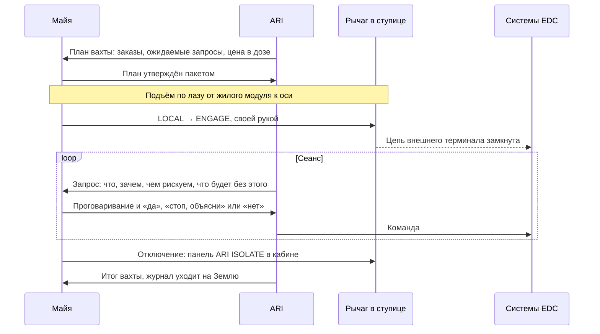

# Вычислительная вахта

Кратко: это то, что продаёт корабль. Calder Deep Space продаёт вычисления на месте: ARI с собственным дата-центром и реактором приходит туда, где мощный ИИ нужен без задержки сигнала, подключается к системам клиента и работает на них. Одна такая работа в одной точке называется вахтой (compute watch). Первая вахта — у Европы, для Europa Development Consortium (EDC). Решения [D-012](../90-reference/decisions.md) и D-013.

## Что продаётся

Клиент получает три вещи, которых у него нет по отдельности.

- **Мощность.** Машины EDC на Европе работают на радиационно стойкой электронике, а она на порядки медленнее обычной. В радиационных поясах Юпитера быстрые чипы долго не живут ([радиационная среда](../50-science/jovian-radiation.md)). ARI считает в защищённом хранилище корабля ([ядро ARI](../30-ship/systems/ari-core.md)).
- **Близость.** С Земли сигнал до Юпитера идёт ≈33–54 мин в одну сторону ([связь с Землёй](earth-link.md)), а с рабочей стоянки корабля до Европы — секунды и меньше ([стоянка и подходы](europa-encounters.md)).
- **Законность.** ИИ уровня ARI выполняет действия класса IV (стыковка, посадка, манёвр, всё необратимое) только с подтверждения человека, который находится в контуре управления в реальном времени. Человека ARI привозит с собой ([закон о человеческом контроле](../10-world/human-authority-law.md)).

Коротко: «ИИ со своим человеком». Так работают ледокол или плавучий кран: их не держат в каждом порту, их вызывают, когда без них не обойтись.

## Какие бывают заказы

| Заказ | Пример у Европы | Нужна ли малая задержка | Что делает Майя |
|---|---|---|---|
| Чужие расчёты | Разбор данных бурения и радарной съёмки льда, пересчёт моделей оболочки, планирование маршрутов | Нет. Важнее широкий канал: сырые данные не нужно гнать на Землю по узкому дальнему каналу | Почти ничего: это советы и прогнозы, класс I. Данные ARI принимает в сеансе, считает и в `LOCAL`, результат отдаёт в следующем сеансе |
| Утверждённые программы | ARI пишет для машин EDC фиксированные последовательности команд на недели вперёд | Нет | Утверждает. Утверждённая человеком последовательность выходит из-под закона, и машины исполняют её уже без корабля |
| Стыковки и перегрузка | Приём грузового модуля, стыковка бурового блока с посадочной платформой | Да, на последних метрах | Подтверждает каждое необратимое действие (класс IV) |
| Сопровождение операций | Посадка, проход через опасный слой льда, запуск зонда в скважину | Да, в критические минуты | Утверждает план пакетом (класс III), подтверждает развилки |
| Пилотирование | ARI сам ведёт машину, когда её автоматика не справляется: нештатная ситуация, сложный рельеф | Да, сильнее всего | Подтверждает вход в ручной режим и всё необратимое |

Вторая строка — тихий, но главный продукт. После ухода корабля у EDC остаются программы, написанные мощным ИИ и подписанные человеком. По [закону](../10-world/human-authority-law.md#исключения) заранее утверждённые людьми последовательности команд исполняет простая автоматика ниже порога, без человека рядом.

## Как идёт вахта

1. **Подход.** ARI выводит корабль в рабочую точку. Где она и сколько там можно находиться — на странице [стоянка и подходы](europa-encounters.md). Заранее Майя получает план вахты: какие заказы, какие решения класса IV ожидаются, сколько это стоит в дозе. План она утверждает пакетом.
2. **Подъём к рычагу.** Рычаг подключения (engage lever) стоит в ступице, у ядра ARI. Майя поднимается к нему по лазу через ферму, и по пути тяжесть тает до невесомости ([рычаг подключения](../30-ship/systems/engage-lever.md)). Это ритуал каждой вахты и узнаваемый кадр сериала.
3. **`ENGAGE`.** По закону перевести рычаг в `ENGAGE` может только человек, своей рукой, на месте, на каждую вахту. Без этого положения у ARI физически нет цепи к чужим системам.
4. **Сеанс.** Майя спускается обратно в жилой модуль: за рабочее место, а на время захода в сильную радиацию — в укрытие ([отсек сна и укрытия](../30-ship/habitat/stasis-shelter.md)). Запросы приходят на экран, ARI делает всё остальное. Длительность сеанса задаёт окно вахты; число не задано, рассчитать вместе со схемой стоянки. Вахта может занимать несколько суток: на ночь Майя сбрасывает рычаг в `LOCAL` из кабины, а утром поднимается снова ([рычаг](../30-ship/systems/engage-lever.md#если-человек-выведен-из-строя), предложение).
5. **Отключение.** Включить трудно, выключить легко: из кабины защищённая панель `ARI ISOLATE` по жёсткой линии сбрасывает рычаг в `LOCAL` или `ISOLATE`. Обычно это конец окна. Но Майя может отключить ARI в любую секунду и без объяснений: по закону «нет» проще, чем «да».
6. **Итог.** Результаты уходят клиенту, журнал подтверждений — на Землю, в Calder Mission Operations и надзор JHP ([люди на Земле](../40-characters/mission-control.md)). Машины EDC до следующей вахты работают по утверждённым программам.

## Кто что делает

| | Майя | ARI |
|---|---|---|
| Рычаг | Переводит в `ENGAGE`; отключает | Не может ни включить, ни удержать включение |
| Решения | Утверждает планы и пакеты, подтверждает действия класса IV с проговариванием, говорит «стоп, объясни» и «нет» | Предлагает, объясняет перед подписью, ведёт журнал |
| Работа | Базовое обслуживание руками, осмотр, следит за своей дозой и годностью к подтверждениям | Все расчёты, планирование, пилотирование машин клиента, навигация корабля |
| Зрители | Рассказывает, что происходит и зачем | Отвечает на её вопросы в кадре |

Майя — сервисный оператор, а не учёный и не пилот. Её шутка из [закона](../10-world/human-authority-law.md#практика-и-критика) «я жму Enter» здесь буквальна: почти всё время она подтверждает правильные запросы. Её работа в том, чтобы однажды не подтвердить неправильный. Вокруг вахты стоят ещё трое: EDC ставит задачи и платит, Calder продаёт время ARI и планирует маршрут вахт, JHP Partnership лицензирует операцию и следит за законом ([организации](../10-world/organizations.md)).

## Почему не постоянный дата-центр у Европы

Главный довод юридический, остальные его усиливают.

1. **Закон превращает дата-центр в обитаемую базу.** ИИ уровня ARI, стоящий у Европы постоянно, без человека в контуре не может выполнить ни одного действия класса IV. Подтверждать с Земли нельзя: петля подтверждения по закону должна укладываться в 10 секунд туда и обратно, а до Земли — десятки минут. Значит, постоянный ИИ у Европы требует постоянного экипажа у Европы: жильё, защиту от радиации, смены, медицину, эвакуацию. Корабль привозит одного человека на время вахты и увозит.
2. **Радиация.** Орбита Европы лежит внутри мощных радиационных поясов Юпитера (JPL). Стационарная база стоит в поясах всегда. Корабль держит стоянку дальше от Юпитера и заходит ближе редко и ненадолго, как Europa Clipper.
3. **Неровный спрос.** Тяжёлые вычисления нужны пиками: посадка, стыковка, проход через лёд, разбор аварии. Между пиками машины работают по утверждённым программам, и стационарный дата-центр большую часть времени простаивал бы. Корабль обслуживает несколько точек по очереди ([дальнейшие этапы](future-arcs.md)).
4. **Железо стареет.** Вычислитель базы навсегда остался бы поколения года запуска. Флот кораблей обновляется: следующий корабль класса приходит с новым железом. Это довод слабее первых трёх: замена корабля тоже стоит денег и лет.

## Где стоит корабль во время вахты

Близко к Европе — малая задержка и большая доза. Далеко — наоборот. Черновая стратегия: стоять там, где доза терпима, а задержка — секунды, и делать короткие подходы для операций, которым нужна малая задержка. Каждый подход тратит бюджет дозы Майи. Подробности и варианты — [стоянка и подходы](europa-encounters.md), путь туда — [тур по системе Юпитера](jovian-tour.md).

## Основания
> [!verified] Проверено
> - Радиация в районе Европы опасна для аппаратов и людей; орбита Европы лежит внутри радиационных поясов Юпитера. Europa Clipper защищает электронику хранилищем и проводит у Европы меньше суток за виток (JPL, Europa Clipper Press Kit: https://www.jpl.nasa.gov/press-kits/europa-clipper/).
> - Прецедент «управлять Европой из более спокойного места рядом»: исследование NASA HOPE (2003) выбрало для людей Каллисто, «mostly outside of radiation belts», и среди задач экипажа указало дистанционное управление подводным аппаратом в океане Европы в течение 30 суток (Troutman et al., NASA Langley, STAIF-2003; https://ntrs.nasa.gov/citations/20030063128; слайды доклада).
> - Задержка даже в секунды опасна для дистанционного вождения: в испытаниях NASA 2023 года лунный вездеход вели с Земли при задержках 0, 4, 6 и 8 с; авторы пишут, что задержка порядка секунд легко приводит к повреждению или потере машины (Litaker et al., NASA JSC, https://ntrs.nasa.gov/citations/20240011392).

> [!fiction] Вымысел
> Вычисления как услуга у Юпитера, EDC, Calder Deep Space, JHP Partnership, закон о человеческом контроле с петлёй 10 секунд и рычаг подключения — вымысел мира (D-010, D-012, D-013). Электроника машин EDC и её скорость — допущения.

> [!production] Решение для производства
> Вахта даёт сериалу повторяемую структуру: план, подъём к рычагу, `ENGAGE`, сеанс, отключение. Подъём по лазу — один и тот же узнаваемый кадр, а само содержание сеанса меняется от заказа к заказу.

## Связи
- [Цель миссии](mission-purpose.md) — зачем вообще летит корабль.
- [Стоянка и подходы у Европы](europa-encounters.md) — где идёт первая вахта и чем платит доза.
- [Попутные задачи](science-program.md) — что корабль делает в промежутках между вахтами.
- [Хронология миссии](mission-timeline.md) — место первой вахты на оси миссии.
- [Дальнейшие этапы](future-arcs.md) — следующие точки.
- [Рычаг подключения](../30-ship/systems/engage-lever.md) и [ядро ARI](../30-ship/systems/ari-core.md) — железо вахты.
- [ARI](../40-characters/ari.md) и [Майя](../40-characters/maya.md) — кто работает.
- [Закон о человеческом контроле](../10-world/human-authority-law.md) — классы действий, петля 10 секунд, утверждённые программы.
- [Организации](../10-world/organizations.md) — Calder, EDC, JHP.

## Открытые вопросы
- Длительность первой вахты, число сеансов и окон в ней — решить вместе со схемой стоянки ([стоянка и подходы](europa-encounters.md)).
- Сколько раз за вахту Майя поднимается к рычагу. По странице [рычага](../30-ship/systems/engage-lever.md) данные клиента идут только в `ENGAGE`, а считать их ARI может и в `LOCAL`; значит, чистые расчёты требуют коротких сеансов приёма и выдачи, а не постоянного подключения. Подтвердить.
- Прочтение закона: включает ли петля «запрос → человек → ответ → исполнитель» путь сигнала до машины у Европы. Если да, у стоянки есть юридический предел удаления (см. [стоянка и подходы](europa-encounters.md#задержка-сколько-секунд-до-европы)).
- Экономика: кто сколько платит, что дешевле для EDC — вахта или ожидание. Числа не придумываем.
- Что происходит с вахтой, если Майя выведена из строя во время `ENGAGE` (D-013).
