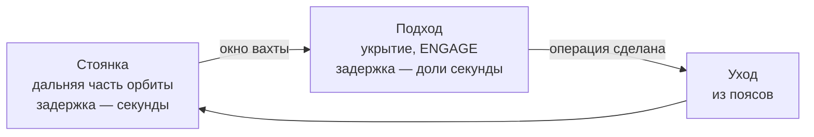

# Европа — стоянка и подходы

Кратко: первая [вахта](compute-service.md) идёт у Европы, но жить рядом с ней нельзя: орбита Европы лежит внутри мощных радиационных поясов Юпитера. Черновая стратегия: корабль стоит дальше от Юпитера, где доза терпима, а до Европы секунды светового времени, и делает короткие подходы для операций, которым нужна малая задержка. Каждый подход тратит бюджет дозы Майи. Это ещё не решение: выбор схемы — в «Открытых вопросах». Все числа доз, высот и периодов пока не рассчитаны.

## Почему нельзя стоять у Европы

- **Пояса.** По данным JPL, орбита Европы лежит внутри мощных радиационных поясов Юпитера, и эта радиация опасна и для аппаратов, и для людей.
- **Даже за бронёй.** Электроника Europa Clipper в специальном защищённом хранилище получает за один пролёт Европы в среднем от нескольких тысяч до десятков тысяч рад. Рад — это 0,01 грея, то есть за пролёт выходят десятки грей и больше (расчёт). Карьерный предел NASA для астронавта — 600 мЗв эффективной дозы за все полёты (NASA-STD-3001). Доза электроники за стенкой и эффективная доза человека — разные величины, но разрыв в десятки раз и больше говорит ясно: заходить к Европе так, как Clipper, с защитой уровня Clipper человеку нельзя.
- **Как поступают реальные аппараты.** Clipper проводит в опасной зоне у Европы меньше суток за виток, уходит из самой сильной радиации и возвращается через две-три недели (JPL). Корабль Майи наследует эту логику: у Европы — коротко, остальное время — дальше от Юпитера.

## Задержка: сколько секунд до Европы

С Земли до Юпитера сигнал идёт ≈33–54 мин в одну сторону. Внутри системы Юпитера — секунды. Предварительный расчёт по большим полуосям орбит спутников (JPL) и скорости света; корабль считается на круговой орбите вокруг Юпитера на том же расстоянии, что и спутник; перенести в `calc/`:

| Где стоит корабль | До Европы в одну сторону (расчёт) | Радиация |
|---|---|---|
| На орбите Европы, впереди или позади неё | от 0 до ≈4,5 с | пояса: как у самой Европы (JPL) |
| На расстоянии орбиты Ганимеда от Юпитера | ≈1,3–5,8 с | слабее, чем у Европы; доза — найти источник |
| На расстоянии орбиты Каллисто | ≈4,0–8,5 с | «mostly outside of radiation belts» (NASA HOPE) |
| Земля | ≈33–54 мин | — |

Для сравнения: до Луны с Земли около 1,28 с ([закон о человеческом контроле](../10-world/human-authority-law.md#требование-задержки)). Лунные операции по закону можно подтверждать с Земли.

Из таблицы следуют два ограничения.

- **Юридическое (по нашему прочтению закона).** Петля «запрос → человек → ответ → исполнитель» должна укладываться в 10 секунд туда и обратно. Если исполнитель — машина EDC на Европе, корабль во время подтверждений класса IV должен быть не дальше примерно 5 световых секунд от неё, то есть около 1,5 млн км (расчёт). С расстояния орбиты Каллисто это выполняется примерно в четверти синодического цикла, с расстояния орбиты Ганимеда — примерно в двух третях (расчёт для круговых компланарных орбит).
- **Инженерное.** Даже несколько секунд — много для тонкой работы. В испытаниях NASA 2023 года лунный вездеход вели с Земли при задержках 4, 6 и 8 с, и авторы делают вывод: задержка порядка секунд легко приводит к повреждению или потере машины (Litaker et al., NASA JSC). ARI предсказывает лучше человека-водителя, но задержка мешает любому регулятору. Поэтому расчёты, планы и утверждённые программы можно делать со стоянки, а последние метры стыковки и посадки — только с подхода.

## Варианты схемы

| Схема | Задержка до Европы | Доза | Чем хороша | Чем плоха |
|---|---|---|---|---|
| **А. Орбита у самой Европы** | доли секунды | неприемлема | всё в реальном времени | человек там не выживет долго; отклонить |
| **Б. Вытянутая орбита с заходами** (как Clipper) | от долей секунды на подходе до секунд вдали | короткие пики у Европы, остальное время меньше | подходы получаются сами, по орбите; повторяет сетку сезона из исходника: Европа приходит и уходит | подход по расписанию орбиты, а не по желанию клиента; доза за подход — рассчитать |
| **В. Круговая стоянка дальше Европы + отдельные подходы** | секунды на стоянке | умеренная, источник нужен | подход тогда, когда нужен | каждый подход стоит топлива |
| **Г. Стоянка у Каллисто** (как NASA HOPE) | ≈4,0–8,5 с | минимальная | безопаснее всего; реальный прецедент | по нашему прочтению закона класс IV законен лишь около четверти цикла; для тонкой работы всё равно нужны подходы |

**Рекомендация: Б.** Стоянка — это дальняя, спокойная часть вытянутой орбиты вокруг Юпитера. Там ARI считает, пишет программы и следит за машинами с задержкой в секунды. Подход — это проход у Европы раз за виток: окно для стыковок, посадок и пилотирования. Период орбиты подстраивают пролётами спутников, как это делают Clipper и JUICE ([тур](jovian-tour.md)). Схема дешёвая по топливу и опирается на реальную практику. И она сохраняет визуальную грамматику исходника: Европа вырастает, проходит рядом и уменьшается, а «next time, closer» становится буквальным расписанием работы. Резерв — В, если клиенту нужны подходы не по расписанию орбиты.

Как это выглядит на борту: перед подходом Майя поднимается к рычагу, переводит его в `ENGAGE` ([вахта](compute-service.md#как-идёт-вахта)) и до входа в пояса спускается в укрытие ([отсек сна и укрытия](../30-ship/habitat/stasis-shelter.md)). Подтверждения она даёт с экрана в укрытии. Рычаг остаётся в `ENGAGE`, а отключить ARI можно из кабины.

## Бюджет дозы

Бюджет дозы (dose budget) — предельная доза Майи на всю миссию, которую ARI ведёт как счёт: сколько потрачено, сколько осталось, сколько стоит следующий подход. Расход идёт по статьям:

- фон перелёта (галактические космические лучи);
- выход на орбиту и переход через пояса ([прибытие](jupiter-arrival.md), [тур](jovian-tour.md));
- стоянка: медленный постоянный расход;
- подходы: крупные разовые траты.

Почему это хороший сквозной элемент влога:

- **Видно цену решения.** Каждый подход ARI предлагает с ценой в дозе, Майя решает. По смыслу закона доза, которую тратит человек, — это «невосполнимое понемногу», класс III; глубокий подход может стать классом IV. Решить.
- **Есть счётчик.** Остаток бюджета естественно смотрится на статусной строке рядом с задержкой связи ([дисплеи](../30-ship/habitat/displays-and-controls.md)).
- **Спокойно, без катастроф.** Это бухгалтерия, а не авария: «this pass costs me about … of my budget». Число — только после расчёта.

Реальные ориентиры для будущего числа: NASA ограничивает карьерную эффективную дозу астронавта 600 мЗв, дозу от одной солнечной вспышки расчётного уровня — 250 мЗв, облучение от ядерных установок на борту — 20 мЗв за год миссии (NASA-STD-3001, том 1). Каким будет предел 2050-х для оператора у Юпитера — решение мира.

## Как ложится сетка сезона 1 из исходника

Исходник строил эпизоды 8–12 вокруг научного пролёта. Под вахту их нужно пересмотреть; предложение — сохранить ход «приближение — проход — уход — снова», поменяв смысл.

| Эпизод исходника | Было | Предложение |
|---|---|---|
| 8 «Europa finally looks like a place» | Европа ясно видна, лёд, океан | То же, плюс где на ней работают машины EDC и зачем |
| 9 «What we're actually measuring» | приборы и данные | «Что мы здесь делаем»: заказы, программы, рычаг ([попутные задачи](science-program.md) — отдельно) |
| 10 «Europa pass» | ближайший пролёт, без кризиса | первый подход: `ENGAGE`, первая стыковка или посадка, Майя тихая и сосредоточенная |
| 11 «And now we leave it again» | уход на новую петлю | уход на стоянку; работа продолжается, машины идут по утверждённым программам |
| 12 «See you next orbit» | «Next time, closer.» | следующий подход ближе, если позволит бюджет дозы |

Привязка эпизодов к отсчёту — в [хронологии миссии](mission-timeline.md); раздел 70-series не меняется ([сезон 1](../70-series/season-1.md)).

## Что известно о реальной Европе

Справка — [Европа](../50-science/europa.md). Кратко: яркая ледяная поверхность и предполагаемый подповерхностный океан. Реальные встречи: Galileo — 11 пролётов, Juno — пролёт 29 сентября 2022, Europa Clipper — 49 пролётов, JUICE — два пролёта в июле 2032 на высоте 401 км ([реальные миссии-прототипы](../50-science/reference-missions.md)). Научные утверждения в репликах держим консервативными и подкрепляем источником до финального сценария.

## Что говорит Майя

Короткие реплики, много молчания на подходе. Она говорит о том, что видит, и о работе: кто там внизу, что делает ARI, почему она сидит в укрытии. Числа (высота подхода, скорость, доза) звучат только после расчёта.

## Связи
- [Вычислительная вахта](compute-service.md) — что происходит на подходе и на стоянке.
- [Тур по системе Юпитера](jovian-tour.md) — как корабль попадает на рабочую орбиту.
- [Прибытие к Юпитеру](jupiter-arrival.md) — первая доза: выход на орбиту.
- [Попутные задачи](science-program.md) — наблюдения Европы между заказами.
- [Хронология миссии](mission-timeline.md) — первая вахта на оси миссии.
- [Дальнейшие этапы](future-arcs.md) — куда после Европы.
- [Европа](../50-science/europa.md) и [радиационная среда Юпитера](../50-science/jovian-radiation.md) — реальные условия.
- [Радиационная защита](../30-ship/systems/radiation-protection.md) и [отсек сна и укрытия](../30-ship/habitat/stasis-shelter.md) — чем корабль закрывает Майю.
- [Рычаг подключения](../30-ship/systems/engage-lever.md) — что переводят в `ENGAGE` перед подходом.
- [Закон о человеческом контроле](../10-world/human-authority-law.md) — петля 10 секунд и классы действий.
- [Связь с Землёй](earth-link.md) — задержка, от которой вахта избавляет.
- [Сезон 1](../70-series/season-1.md) — эпизоды 8–12.

## Основания
> [!verified] Проверено
> - Орбита Европы внутри мощных радиационных поясов; радиация опасна для аппаратов и людей; электроника Clipper в хранилище за пролёт получает в среднем от нескольких тысяч до десятков тысяч рад; меньше суток в опасной зоне за виток, возврат через две-три недели; 49 пролётов (JPL, Europa Clipper Press Kit, https://www.jpl.nasa.gov/press-kits/europa-clipper/).
> - Карьерный предел эффективной дозы 600 мЗв, 250 мЗв на расчётную солнечную вспышку, 20 мЗв за год миссии от ядерных установок (NASA-STD-3001, том 1, требования V1 4030–4032; техническая справка NASA OCHMO: https://www.nasa.gov/wp-content/uploads/2023/03/radiation-protection-technical-brief-ochmo.pdf).
> - Каллисто «mostly outside of radiation belts»; задача экипажа HOPE — дистанционно управлять подводным аппаратом в океане Европы 30 суток (Troutman et al., NASA Langley, STAIF-2003, https://ntrs.nasa.gov/citations/20030063128; слайды доклада).
> - Задержка порядка секунд опасна для дистанционного вождения; испытания при 0, 4, 6 и 8 с (Litaker et al., NASA JSC, https://ntrs.nasa.gov/citations/20240011392).
> - Большие полуоси Европы 671 100 км, Ганимеда 1 070 400 км, Каллисто 1 882 700 км (JPL, https://ssd.jpl.nasa.gov/sats/elem/); световое время — расчёт.
> - Европа, пролёты Galileo, Juno, JUICE — см. [Европа](../50-science/europa.md).

> [!fiction] Вымысел
> Схема стоянки, подходы, бюджет дозы, рабочая орбита и защита корабля — допущения мира. Петля 10 секунд — из вымышленного [закона](../10-world/human-authority-law.md); то, что она включает путь до машины на Европе, — наше прочтение.

> [!production] Решение для производства
> Рекомендованная схема Б сохраняет главный визуальный ход исходника: Европа появляется, проходит рядом и уходит, а финал «Next time, closer» остаётся. Подход подаётся без кризиса: укрытие, экран, тихая работа.

## Открытые вопросы
- **Схема стоянки.** Рекомендация — Б (вытянутая орбита с заходами), резерв — В. Нужно решение пользователя и затем расчёт: период, перицентр, число подходов за вахту ([открытые вопросы](../90-reference/open-questions.md)).
- **Доза за подход и на стоянке.** Источник по дозе для человека на расстояниях Европы, Ганимеда и Каллисто не найден; числа не внесены. Нужны модель поясов и расчёт с защитой укрытия.
- **Предел дозы 2050-х** для оператора у Юпитера и размер бюджета Майи на миссию.
- **Закон.** Подтвердить у раздела «Мир», что петля 10 секунд включает путь до исполнителя у Европы.
- **Ступица на подходе.** Если рычаг в ступице, а ступица хуже защищена, чем укрытие, — `ENGAGE` только до входа в пояса. Согласовать с [рычагом](../30-ship/systems/engage-lever.md) и [радиационной защитой](../30-ship/systems/radiation-protection.md).
- Что зритель видит на внешней ленте во время подхода и как это согласуется с реальными снимками Galileo и Clipper.
