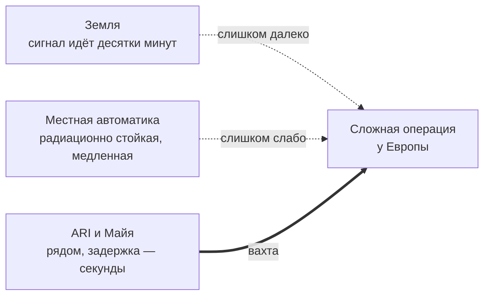

# Цель миссии — вычисления на месте

Кратко: корабль везёт к Юпитеру не экспедицию, а вычисления. Это передвижной вычислительный узел: ARI с собственным дата-центром, реактором и защитой приходит туда, где мощный ИИ нужен без задержки сигнала, и работает на клиентов вахтами. Первая вахта — у Европы, где машины Europa Development Consortium (EDC) осваивают лёд. Майя — сервисный оператор: человек в контуре, без которого ARI по закону не может работать на чужие системы. Решение [D-012](../90-reference/decisions.md).

## Зачем лететь

У Юпитера идёт освоение, и делают его в основном машины: бурят лёд, ставят станции, запускают зонды. Сложные операции им даются плохо по трём причинам.

- **Земля далеко.** Сигнал от Земли идёт ≈33–54 мин в одну сторону ([связь с Землёй](earth-link.md)). Стыковку или посадку так не проведёшь.
- **Местные компьютеры слабы.** В радиационных поясах Юпитера живёт только радиационно стойкая электроника, а она на порядки медленнее обычной ([радиационная среда](../50-science/jovian-radiation.md)).
- **Закон.** ИИ уровня ARI выполняет необратимые действия только с подтверждения человека в контуре, на месте ([закон о человеческом контроле](../10-world/human-authority-law.md)).

Корабль снимает все три ограничения сразу. Он приходит в точку, рычагом подключается к системам клиента, считает чужие задачи, ведёт стыковки, сопровождает операции, пилотирует машины и уходит. Как это устроено и почему это дешевле постоянного дата-центра у Европы — на странице [вычислительная вахта](compute-service.md).

Владелец корабля и ARI — Calder Deep Space: компания продаёт вычисления как услугу и ведёт полёт. Заказчик первой вахты — EDC. Освоение системы Юпитера координирует JHP Partnership: лицензирует операции и следит за законом ([организации](../10-world/organizations.md)).

## Почему одна Майя

- **Минимум по закону.** На каждую систему выше порога, способную на действия класса IV, нужен один ответственный человек; двое — только для класса V, а его на корабле нет. Подтверждать с Земли нельзя, значит, человек летит с ИИ ([D-010](../90-reference/decisions.md)).
- **Сервисный оператор, а не учёный.** Майя — рука на рычаге и подпись под каждым необратимым решением. У неё базовая инженерная подготовка, а профессию оператора вахты она освоила за перелёт, в режиме [активного сна](stasis.md) (D-014).
- **Почему согласилась.** На Земле 2050-х ей светила комната в девять квадратных метров и долгая работа за еду. Вахта к Юпитеру выносит её в следующую лигу ([предыстория](../40-characters/maya-backstory.md), D-015). В сериале это прямо не проговаривается.

## Работа, а не приключение

- **Питч.** «A young woman is traveling alone through the Solar System in the 2050s and casually vlogs the mission from inside a physically consistent spacecraft.» Миссия вымышленная; пункты назначения, орбитальная механика, астрономия максимально реальны.
- **Экипаж: 1 человек.** Бортовой ИИ — [ARI](../40-characters/ari.md).
- **Часть работы.** Для Майи Юпитер, огромный в иллюминаторе, одновременно необычен и «part of the job». Она уже приняла странность своей жизни.
- **Первое впечатление.** «This woman has been living here for a while, and we have just discovered her vlog.» К первому кадру она давно проснулась, обжилась, проверила корабль и вернулась к нормальной жизни.

## Предпосылка сезона 1

Влог начинается за 21 день до выхода на орбиту Юпитера ([хронология](mission-timeline.md), D-011). Майя приближается к рабочей точке и по пути рассказывает:

- как попала сюда и на кого работает ([запуск и сборка](launch-and-assembly.md));
- как «проспала» три года и за это время выучилась на оператора ([активный сон](stasis.md), [перелёт](interplanetary-cruise.md));
- почему корабль не летит прямо к Европе ([тур](jovian-tour.md), [гравманёвр](../50-science/gravity-assist.md));
- о выходе на орбиту — первом большом «да» ([прибытие](jupiter-arrival.md));
- что такое вахта и рычаг ([вычислительная вахта](compute-service.md));
- о Европе, о машинах EDC на ней и о бюджете дозы ([стоянка и подходы](europa-encounters.md));
- обо всём интересном по пути ([попутные задачи](science-program.md));
- о нормальной жизни между делами ([быт Майи](../40-characters/maya-daily-life.md)).

Крупных катастроф нет. Сезон о радости постепенного прибытия в невообразимо далёкое место и о странной работе, которая там ждёт ([концепция](../70-series/series-concept.md)).

## Наука — попутная

Миссия не держится на научной программе: ей не нужно отвечать на вопрос «зачем человек там, где справляются автоматические зонды». Наука остаётся попутной: технические испытания, наблюдения в пути, просьбы клиентов ([попутные задачи](science-program.md)). Европа интересна и без неё: под ледяной оболочкой предполагается солёный океан ([Европа](../50-science/europa.md)).

## Что Майя знает и как говорит о работе

- **Не читает лекции.** Она объясняет то, что происходит вокруг неё. Не «Europa is one of Jupiter's Galilean moons…», а, например: «We're not actually trying to stop at Europa on this pass. We're borrowing Ganymede to bend the orbit, then we come back around Jupiter and meet Europa again.»
- **Честна насчёт своей роли.** ARI делает почти всё; она подтверждает и может остановить. «Я, скорее всего, нажму "да". Но это моя ответственность» (D-010). Черновая реплика: «I'm not a scientist. I'm the person who is legally required to be here.»
- **Знает маршрут и его логику:** почему обходной путь экономит топливо, почему стоять у Европы нельзя.
- **Упоминает перелёт мимоходом:** «I slept through most of the cruise. A little over three years, depending on where you count it from.»
- **Не называет точных орбитальных чисел и доз**, пока они не рассчитаны.
- **Не утверждает, что сегодняшний Starship способен на такую миссию:** это вымышленная инфраструктура 2050-х.

## Критерии успеха

Предложение: вахта успешна, если заказы EDC выполнены, бюджет дозы не превышен, в журнале подтверждений нет ни одного «да» без объяснения на экране, а машины клиента после ухода корабля работают по утверждённым программам. Что считается финалом сезона 1 — решить вместе с пересмотром эпизодов ([хронология](mission-timeline.md)).

## Связи
- [Вычислительная вахта](compute-service.md) — что продаёт корабль и как идёт работа.
- [Стоянка и подходы у Европы](europa-encounters.md) — первая рабочая точка.
- [Попутные задачи](science-program.md) — что делается между делом.
- [Майя](../40-characters/maya.md) и [предыстория](../40-characters/maya-backstory.md) — кто она и почему согласилась.
- [ARI](../40-characters/ari.md) — главный исполнитель.
- [Организации](../10-world/organizations.md) — Calder Deep Space, EDC, JHP Partnership.
- [Закон о человеческом контроле](../10-world/human-authority-law.md) — почему на борту человек.
- [Сезон 1](../70-series/season-1.md) — эпизоды исходника, которые нужно пересмотреть.
- [Жилой модуль](../30-ship/habitat/index.md) — «машина, которая годами держит одного человека живым» (SPEC §41).

## Основания
> [!verified] Проверено
> Реальные аппараты к Европе — автоматические: Europa Clipper запущен 14 октября 2024, цель — определить, есть ли у Европы условия, пригодные для жизни (https://science.nasa.gov/mission/europa-clipper/); ESA JUICE нацелен на ледяные спутники Ганимед, Европа, Каллисто (https://www.esa.int/Science_Exploration/Space_Science/Juice/Juice_factsheet). Науку у Европы делают роботы, поэтому миссия Майи держится на другом.

> [!fiction] Вымысел
> Освоение Европы машинами, вычисления как услуга, Calder Deep Space, EDC, JHP Partnership, закон о человеческом контроле, пилотируемый полёт к Юпитеру и активный сон — допущения мира (D-010, D-012, D-014, D-015; `sources/space_vlog_series_concept_v2.md`, «NOT CONFIRMED / fictional»).

> [!production] Решение для производства
> Объяснения подаются через работу героини и события вокруг неё, а не через лекции; это держит тон «почти разочаровывающе нормальным» (`sources/space_vlog_series_concept_v2.md`, «Production north star»).

## Открытые вопросы
- Что именно EDC делает на Европе и зачем ему это: добыча, наука на продажу, подготовка базы ([организации](../10-world/organizations.md)).
- Критерии успеха первой вахты и финал сезона 1.
- Сколько вахт и точек входит в контракт Майи; когда и как она возвращается ([дальнейшие этапы](future-arcs.md)).
