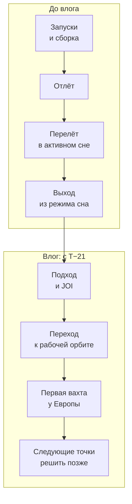

# Хронология миссии

Кратко: каркас фаз миссии от запуска до первой вахты у Европы и привязка эпизодов сезона 1 к этим фазам. Дат, длительностей, расстояний и скоростей здесь нет и не будет, пока для вымышленной траектории не выполнен расчёт; каждое такое число помечено «рассчитать».

## Правило

Даты, длительности, расстояния, скорости и высоты не придумываются на глаз. Они появляются здесь только после расчёта траектории (`calc/`) или из источника, после чего записываются в `data/canon.yaml`, а в текст попадают привязкой к канону. Ориентир мира: события происходят в 2050-х.

## Фазы

| Фаза | Страница | Дата начала | Длительность | Статус |
|---|---|---|---|---|
| Запуски и сборка на орбите | [Запуск и сборка](launch-and-assembly.md) | рассчитать | рассчитать | не определено |
| Отлёт к Юпитеру | [Запуск и сборка](launch-and-assembly.md) | рассчитать | рассчитать | не определено |
| Перелёт в активном сне (23/1) | [Перелёт](interplanetary-cruise.md), [активный сон](stasis.md) | рассчитать | рассчитать; черновая реплика Майи: «a little over three years» | не определено |
| Выход из режима сна, обычный ритм | [Активный сон](stasis.md#выход-из-режима) | примерно за 2–3 месяца до JOI (предложение) | рассчитать | предложение |
| Подход к Юпитеру; старт влога | [Прибытие](jupiter-arrival.md) | T−21 (D-011) | 21 день | решено отсчётом |
| Выход на орбиту Юпитера (JOI) | [Прибытие](jupiter-arrival.md) | T0 | рассчитать | не определено |
| Переход к рабочей орбите | [Тур](jovian-tour.md) | после JOI | рассчитать | не определено |
| Первая вахта у Европы | [Вахта](compute-service.md), [стоянка и подходы](europa-encounters.md) | рассчитать | рассчитать; число подходов зависит от схемы стоянки | не определено |
| Следующие точки | [Дальнейшие этапы](future-arcs.md) | решить позже | — | не определено |

Числа предварительных оценок: см. [перелёт](interplanetary-cruise.md) (ориентир хоманова перелёта около 2,7 года) и [расстояния и задержка сигнала](../50-science/distances-and-light-time.md). Они не заменяют траекторию.

## Отсчёт и начало влога

Время миссии вокруг прибытия считается от **JOI** — выхода на орбиту Юпитера, торможения в точке наибольшего сближения: «T−21» значит «21 день до JOI», «T+3» — «3 дня после». Абсолютные даты появятся после расчёта траектории; до тех пор события привязываются к отсчёту ([D-011](../90-reference/decisions.md)).

**Влог начинается в T−21.** Майя к этому моменту давно вышла из режима активного сна и обжилась на борту; выход из режима — примерно за 2–3 месяца до JOI (предложение, см. [активный сон](stasis.md#выход-из-режима)).

| Отсчёт | Юпитер на небе (предварительно) |
|---|---|
| T−21 | около 0,5° — как Луна с Земли |
| T−10 | около 1° |
| T−4 | около 2° |
| T−1 | около 5° |
| последние часы | 10–29° |

Предварительный расчёт главной сессии: скорость подхода около 5,6 км/с (перелёт, близкий к хоманову), наибольшее сближение на 4 радиусах Юпитера. Скорость подхода и высота сближения — свойства будущей траектории; перенести в `calc/` и привязать к канону. Высоту сближения нужно перепроверить и по дозе ([прибытие](jupiter-arrival.md#радиация-при-прибытии)).

Ритм публикаций — три раза в неделю. На подходе время в мире идёт почти вровень с реальным (2–3 дня между постами), статусная строка показывает отсчёт до JOI. Неделя прибытия может идти ежедневно. После JOI допустимы скачки времени — это дневник, дата на экране объясняет пропуск. Переход к рабочей орбите и первая вахта ложатся на посты после JOI; сколько их и какой длины скачки — решить после расчёта тура.

## Эпизоды сезона 1 на оси миссии

**Вся таблица требует пересмотра.** Она составлена по исходнику, где сезон держался на научном пролёте Европы, а кульминация была в эпизоде 10. Теперь кульминация первых недель — JOI около девятого поста (D-011), а смысл миссии — вахта (D-012). Последний столбец — предложение; раздел 70-series не меняется ([сезон 1](../70-series/season-1.md)).

| Эпизод исходника | Где на оси | Подсказка из исходника | Под новую концепцию |
|---|---|---|---|
| 1 «So… I'm going to Jupiter.» | подход, T−21 | Юпитер виден, но ещё сравнительно мал | сохраняется |
| 2 «How I got here» | рассказ о прошлом | предыстория, без новых событий | пересмотреть: активный сон, учёба, на кого она работает |
| 3 «Why we don't fly straight to Europa» | подход | орбитальная схема на экране | сохраняется |
| 4 «My next few months» | подход | план больших петель | пересмотреть: путь к рабочей орбите и вахта |
| 5 «That is actually Jupiter» | подход ближе | Юпитер заметно больше | сохраняется |
| 6 «A normal morning, 600 million kilometres from home» | любой момент | расстояние рассчитать | сохраняется; число — открытый вопрос |
| 7 «Gravity assist» | перед пролётом спутника | одна встреча объясняется | сохраняется |
| 8 «Europa finally looks like a place» | приближение к Европе | Европа ясно видна | сохраняется, плюс машины EDC на ней |
| 9 «What we're actually measuring» | у Европы | приборы и данные | пересмотреть: «что мы здесь делаем» ([попутные задачи](science-program.md)) |
| 10 «Europa pass» | ближайшее сближение | без кризиса | пересмотреть: первый подход и первый `ENGAGE` |
| 11 «And now we leave it again» | уход от Европы | следующая большая петля | пересмотреть: уход на стоянку |
| 12 «See you next orbit» | новая петля | «Next time, closer.» | сохраняется по смыслу: следующий подход |

Не хватает эпизода про JOI как кульминацию отсчёта и эпизода про рычаг подключения; оба нужны при пересмотре. Подробнее о подходах — [стоянка и подходы](europa-encounters.md#как-ложится-сетка-сезона-1-из-исходника).

## Что раскрыть при углублении
- Упрощённая симуляция траектории (`calc/`): задаёт даты и длительности всех фаз.
- Привязка календаря к календарю 2050-х и к хронологии мира ([хронология мира](../10-world/timeline.md)).
- Таблица событий тура и вахты: перицентры, пролёты спутников, подходы к Европе.
- Дата и «возраст» полёта для каждого поста (для статусной строки и ARI).
- Окно запуска и соответствие положениям Земли и Юпитера ([расстояния и задержка сигнала](../50-science/distances-and-light-time.md)).

## Связи
- [Перелёт](interplanetary-cruise.md), [прибытие](jupiter-arrival.md), [тур](jovian-tour.md), [стоянка и подходы](europa-encounters.md) — страницы фаз.
- [Активный сон](stasis.md) — перелёт и выход из режима.
- [Вычислительная вахта](compute-service.md) — что происходит в последней известной фазе.
- [Дальнейшие этапы](future-arcs.md) — фазы после первой вахты.
- [Хронология мира](../10-world/timeline.md) — вехи 2026 → 2050-е, из которых вырастает старт.
- [Расстояния и задержка сигнала](../50-science/distances-and-light-time.md) — ограничения по расстоянию и времени.
- [Сезон 1](../70-series/season-1.md) — эпизоды исходника.
- [Журнал решений](../90-reference/decisions.md) — сюда записываются принятые даты и сроки.

## Основания
> [!verified] Проверено
> Реальных данных об этой вымышленной миссии нет; реальные ориентиры других миссий (Galileo, Juno, Europa Clipper, JUICE) — в [справке](../50-science/reference-missions.md).

> [!fiction] Вымысел
> Все даты и длительности миссии — вымышленные данные, второй слой «Reality policy»: могут быть придуманы, но должны быть внутренне согласованы (`sources/space_vlog_series_concept_v2.md`). Фазы активного сна и вахты — D-012, D-014.

> [!production] Решение для производства
> Страница служит каркасом для будущего расчёта; ни одно число сюда не попадает на глаз.

## Открытые вопросы
- Все даты и длительности, помеченные «рассчитать», — [открытые вопросы](../90-reference/open-questions.md).
- Пересмотр эпизодов сезона 1 под отсчёт до JOI и под вахту: что остаётся, что заменяется, где JOI и первый `ENGAGE`.
- Сколько постов после JOI занимает путь к рабочей орбите и укладывается ли первая вахта в сезон 1.
