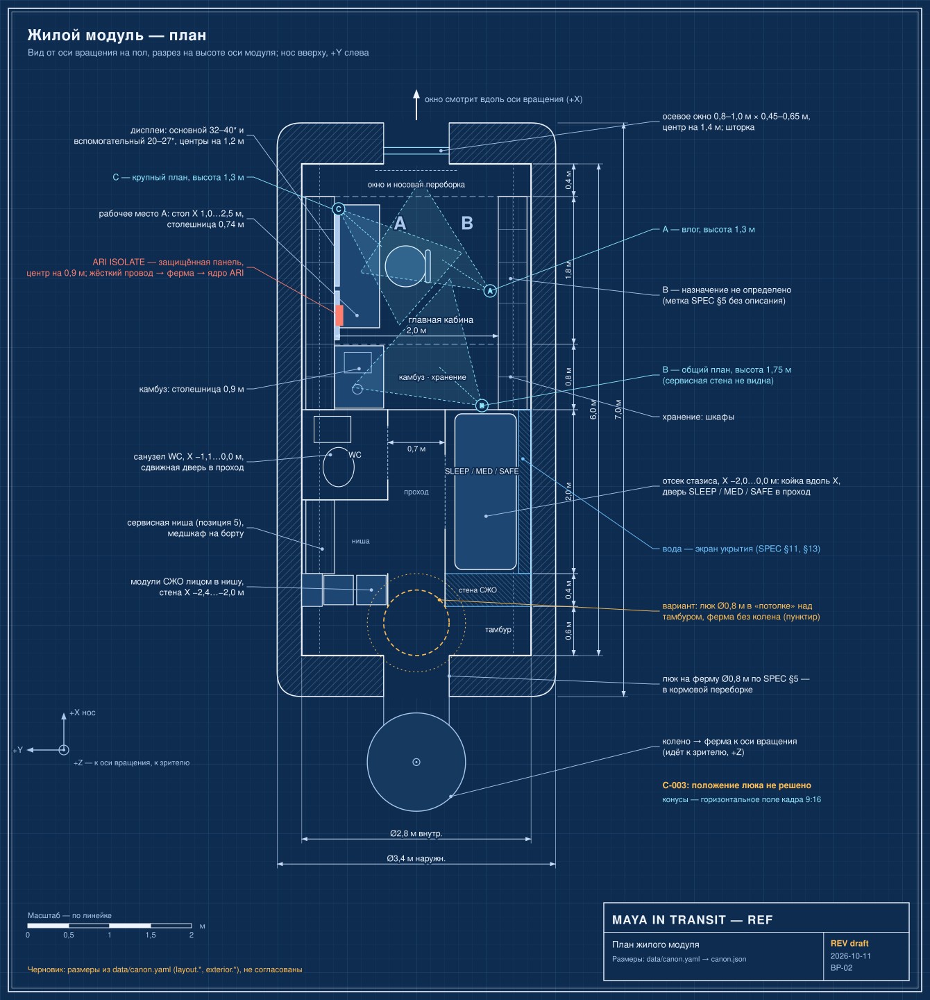

# Дисплеи, статусная строка и органы управления

Кратко: рабочее место оснащено двумя экранами, тонкой постоянной статусной строкой и небольшой группой физических защищённых переключателей. Большая часть взаимодействия идёт голосом и касанием; физические органы нужны для действий, которые не должны выполняться случайно.

*План жилого модуля (BP-02). От носа к корме: окно, главная кабина с рабочим местом, камбуз и хранение, санузел и отсек стазиса по сторонам прохода, сервисная стена, люк к ферме (пунктир — вариант люка в «потолке», C-003). Камеры A/B/C показаны с конусами обзора.*

## Установка

Гигантских фантастических голограмм нет. Дисплеи должны выглядеть как узнаваемые экраны и пульты.

### Основной дисплей
Эквивалент 32–40 дюймов (≈81–102 см по диагонали). Функции:
- траектория;
- навигация;
- научные данные;
- виды внешних камер;
- связь;
- выход ARI.

### Вторичный дисплей
Эквивалент 20–27 дюймов (≈51–69 см). Функции:
- состояние корабля;
- чек-листы;
- телеметрия;
- жизнеобеспечение;
- таймеры.

### Тонкая статусная строка
Всегда видна. Предлагаемые данные:
- время корабля;
- состояние ускорения;
- вращение и гравитация;
- давление в кабине;
- состояние кислорода;
- состояние CO2;
- запас воды;
- следующий манёвр;
- задержка связи.

Prompt 13 перечисляет восемь пунктов: время корабля, вращение/гравитация, давление в кабине, O2, CO2, вода, следующий манёвр, задержка связи; пункта «состояние ускорения» там нет (см. вопросы).

## Физические органы управления

Большинство действий можно выполнять касанием и голосом, но модель должна включать небольшую группу явно физических органов. Они должны выглядеть защищёнными и трудно задеваемыми случайно. Они нужны для:

- аварийного питания (см. [энергетика](../exterior/power-reactor.md));
- связи (см. [связь](../systems/communications.md));
- изоляции пожара (см. [пожарная безопасность](safety-equipment.md));
- управления люком;
- ручного запрета двигателей (см. [навигация и ориентация](../systems/navigation-and-attitude.md));
- ручной отмены систем жизнеобеспечения (см. [жизнеобеспечение](../systems/life-support.md)).

Проектное допущение: Майя может вручную отменять защитные системы (SPEC §40).

## Экранные шаблоны для ARI

Каждым экраном может управлять ARI. Это важно: диалог создаёт визуальное разнообразие без перестройки декорации. Повторно используемые шаблоны экранов (SPEC §36):

1. орбитальная карта;
2. схема системы;
3. поток камеры Европы / Юпитера;
4. научное изображение;
5. состояние жизнеобеспечения;
6. сообщение связи;
7. чек-лист;
8. схема обслуживания;
9. хронология;
10. упрощённая схема «объяснение для зрителя».

Подробности производственной стороны — в [экранных шаблонах](../../70-series/screen-templates.md).

## Как это работает в кадре

- Майя говорит естественно, например: «ARI, put the Europa trajectory on the main screen.» ARI отвечает через динамики кабины; Майя может его перебить.
- ARI может менять содержимое экранов, не требуя прикосновений Майи.
- Ощущение — как у очень продвинутой операционной системы, а не как у второго физического персонажа (SPEC §7).
- Видимые элементы ARI: микрофоны в потолке/консоли, небольшие решётки динамиков, ненавязчивый индикатор, волна или иконка на экранах, подсветка элементов интерфейса, субтитры при необходимости ([ARI в корабле](../systems/ari-interfaces.md)).

## Статус в производстве

Основной и вторичный дисплеи входят в список «моделировать в высоком качестве» для сезона 1 (SPEC §33; [минимальный набор ассетов](../../70-series/asset-list.md)). Коллекция Blender: `INT_WORKSTATION`. Содержимое экранов подменяется шаблонами.

## Что раскрыть при углублении
- Размеры экранов в метрах, положение относительно кресла, угол наклона (пункт чек-листа заморозки «main display size»).
- Эталонная раскладка статусной строки: порядок, шрифт, цвета, пиктограммы; решение по пункту «состояние ускорения».
- Конструкция защищённых переключателей: крышки, цвета, подписи, привязка каждого к системе (согласовать с [материалами и маркировкой](materials-and-markings.md)).
- Набор шаблонов экранов: макеты десяти шаблонов (связь с 70-series).
- Правила безопасных зон для субтитров и графики ARI в вертикальном кадре 9:16 (промпт 06; [камеры сериала](../../70-series/cameras.md)).

## Связи
- [Рабочее место](command-station.md) — где стоят экраны.
- [Геройская стена](hero-wall.md) — экраны и органы управления как лицо интерьера.
- [ARI в корабле](../systems/ari-interfaces.md) — как ИИ управляет экранами и откуда говорит.
- [Экранные шаблоны](../../70-series/screen-templates.md) — десять шаблонов с производственной стороны.
- [Жизнеобеспечение](../systems/life-support.md), [связь](../systems/communications.md), [навигация и ориентация](../systems/navigation-and-attitude.md) — системы, которые отражает статусная строка.
- [Задержка связи с Землёй](../../20-mission/earth-link.md) — откуда берётся «communications delay» на строке.

## Основания
> [!fiction] Вымысел
> ИИ ARI уровня общего назначения не существует; нейроинтерфейсы и ИИ-оболочка 2050-х — допущения мира (SPEC §39). Майя может вручную отменять защитные системы (SPEC §40).

> [!production] Решение для производства
> Никаких гигантских голограмм; экранные шаблоны под управлением ARI дают разнообразие без перестройки декорации (SPEC §6, §36).

## Открытые вопросы
- Включать ли «acceleration state» в статусную строку (в §6 есть, в Prompt 13 нет)?
- Точное число и состав физических переключателей: SPEC называет шесть назначений, но не говорит, сколько отдельных органов.
- Какие функции экранов относятся к основному, какие ко вторичному, если ARI может перенаправить любые данные на любой экран?
