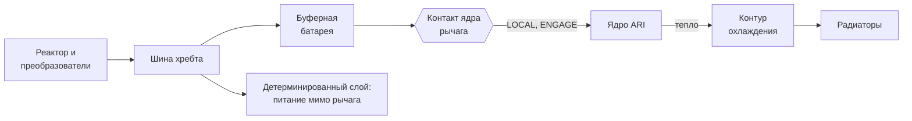
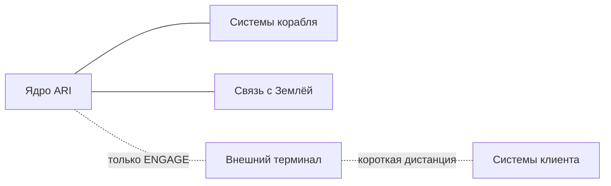

# Ядро ARI

Кратко: вычислительное ядро ARI — по сути небольшой дата-центр в бронированном сейфе на оси корабля, в ступице. Ради него корабль и летит: Calder Deep Space продаёт вычисления там, где они нужны без задержки сигнала ([вычислительная вахта](../../20-mission/compute-service.md)). Голос, экраны и огонёк статуса живут в кабине, а сам ARI — здесь, в двадцати с лишним метрах над головой Майи. Включить ядро и подключить его к чужим системам можно только руками, на месте, [рычагом подключения](engage-lever.md).

*Корабль сбоку (BP-01). Нос справа, корма слева, ось вращения идёт по хребту. Деталь A — ступица: сейф ядра ARI на оси, буферная батарея, баки топлива с кормы, лаз по ферме к ступице, ручной рубильник (теперь крайнее положение рычага подключения) и жёсткая линия ARI ISOLATE.*

## Что это

ARI — программа, ядро — железо, на котором он работает. Это стойки ускорителей, память, накопители с памятью миссии, внутренняя сеть и собственная система охлаждения. В кабине от ARI остаются только «органы чувств»: микрофоны, динамики, экраны ([ARI в корабле](ari-interfaces.md)). Характер и голос описаны на странице [ARI](../../40-characters/ari.md).

У ядра две работы:

1. **Вести корабль.** Навигация, ориентация, баланс вращения, жизнеобеспечение, диагностика, связь, влог — всё, что раньше называлось «ARI управляет почти всеми рутинными функциями» (SPEC §40).
2. **Работать на клиента.** На [вахте](../../20-mission/compute-service.md) ARI считает чужие задачи, ведёт стыковки, сопровождает операции и пилотирует машины заказчика. Первый заказчик — Europa Development Consortium (EDC) ([организации](../../10-world/organizations.md)).

Вторая работа — причина существования корабля (D-012). С Земли сложными операциями у Юпитера управлять нельзя: сигнал идёт десятки минут ([связь с Землёй](../../20-mission/earth-link.md)). А местные компьютеры в радиационных поясах слабы: стойкая к излучению электроника на порядки медленнее обычной. ARI решает обе проблемы сразу. Он рядом, и его быстрое «земное» железо закрыто массой.

### Чем ядро не является

Ядро — не весь «мозг» корабля. Под ним лежит **детерминированный слой** (deterministic layer): простые автоматы на медленной, но радиационно стойкой электронике. Они держат пределы реактора и жизнеобеспечения, вращение и ориентацию при любых командах ([ARI](../../40-characters/ari.md#Архитектура)). Эти автоматы стоят у своих систем, а не в сейфе, и от ядра не зависят. Поэтому ядро можно обесточить, и корабль останется жив.

## Где стоит

Ядро — главный узел корабля, и стоит оно в самом спокойном месте: на оси вращения, в ступице, где корни обеих ферм встречаются с хребтом. Ступица находится на станции 12 м от носа, центр ядра — там же, на 12 м ([центральный хребет](../exterior/central-spine.md#Ступица)).

- **Сейф** (vault) — цилиндр, соосный хребту: Ø2,6 м, длина 3,0 м.
- **Буферная батарея** — кольцевой блок сразу за сейфом к корме, станции 13,5–15,0 м.
- **Баки рабочего тела** — дальше к корме, станции 16–28 м. Они закрывают ядро со стороны реактора и кормы ([двигательная установка и баки](../exterior/propulsion.md), C-007).
- **Пост рычага** — тесная гермоячейка у бока сейфа, в конце лаза по ферме жилого модуля. Там стоит [рычаг подключения](engage-lever.md).

Почему на оси:

- на оси масса ядра не нарушает статический баланс вращения ([навигация и баланс](navigation-and-attitude.md));
- на оси нет центробежной нагрузки, и стойки работают почти в невесомости;
- от ступицы короче всего трассы к обеим фермам и к носовой мачте с внешним терминалом;
- до ядра можно добраться: лаз по ферме ведёт из жилого модуля прямо к посту ([радиальные фермы](../exterior/booms.md#Лаз%20к%20ступице)).

## Питание

Ядро — один из крупных потребителей энергии на борту. Его электрическая мощность — 20–50 кВт от реактора по силовой шине хребта ([реактор и энергетика](../exterior/power-reactor.md)). Буферная батарея на 100 кВт·ч держит ядро несколько часов: этого хватает, чтобы переждать останов и перезапуск реактора.

Питание ядра идёт через силовой контакт рычага подключения. В положении `ISOLATE` контакт разомкнут: ядро обесточено, а батарея отрезана от него и остаётся заряженной на своей стороне контакта.

## Тепло

Почти вся электрическая мощность ядра становится теплом, так что сбросить нужно столько же — те же 20–50 кВт. Тепло уходит контуром теплоносителя по хребту на радиаторы ([терморегулирование](thermal-control.md), [радиаторы](../exterior/radiators.md)). Электронике нужна низкая температура. Низкотемпературный радиатор на каждый киловатт крупнее высокотемпературного, поэтому ядру, вероятно, нужна своя секция радиаторов, отдельная от реакторной (открытый вопрос).

Когда ядро в `ISOLATE`, тепловыделение пропадает. Чтобы сейф не остыл ниже допустимого, его подогреватели питаются мимо рычага, от детерминированного слоя (предложение).

## Защита от радиации

Быстрая электроника не любит излучения, а у Европы оно жёсткое ([радиационная среда Юпитера](../../50-science/jovian-radiation.md)). Ядро защищено по принципу Juno, только крупнее:

- **Сейф.** Металлические стенки не останавливают всё излучение, но резко замедляют старение электроники.
- **Баки** закрывают ядро с кормы. С носа его прикрывает только хребет.
- **Ось.** Ядро в центре масс корабля, и с любой стороны до него есть конструкция.
- **Избыточность.** Коррекция ошибок памяти, запасные узлы, отключение повреждённых модулей.

Защита не бесконечна. У ядра, как и у Майи, есть **бюджет дозы**, и он тоже ограничивает время стоянки у Европы ([встречи с Европой](../../20-mission/europa-encounters.md), [радиационная защита](radiation-protection.md)).

## Связь с миром

Внутри корабля ядро подключено ко всему, что перечисляет Prompt 12: микрофонам, экранам, камерам, навигации, двигателям, жизнеобеспечению, связи, приборам, медицине ([ARI в корабле](ari-interfaces.md)). Наружу ведут два разных канала:

- **Связь с Землёй** — дальняя, медленная, с задержкой в десятки минут. Рычаг её не размыкает ([связь](communications.md)).
- **Внешний терминал** (client link terminal) — короткая дистанция, высокая пропускная способность, только к системам клиента. Его питание и линия данных проходят через контакты рычага и замкнуты только в положении `ENGAGE` ([антенны и датчики](../exterior/antennas-and-sensors.md#Внешний%20терминал)).

Без `ENGAGE` пути к чужим системам нет физически, а не по настройке.

## Ручное обесточивание

Прежний ручной рубильник ядра (D-010) стал крайним положением рычага подключения — `ISOLATE` (D-013). Добраться до ядра можно двумя способами:

- **Из кабины, быстро.** Защищённая панель `ARI ISOLATE` по жёсткой линии сбрасывает рычаг в `LOCAL` (отключить клиента) или в `ISOLATE` (обесточить ядро). Программ в этой цепи нет ([дисплеи и органы управления](../habitat/displays-and-controls.md#Панель%20ARI%20ISOLATE)).
- **В ступице, руками.** Тот же рычаг. Только отсюда ядро можно снова включить.

Что происходит в `ISOLATE`:

- Ядро гаснет. В кабине пропадают голос ARI и огонёк статуса. Экраны переходят на простую телеметрию детерминированного слоя.
- Корабль ведут автоматы. Работают жизнеобеспечение, вращение и баланс, удержание ориентации, маяк и базовая связь с Землёй; реактор уходит в безопасный режим. Манёвров нет, кроме защитных ([закон: применение на корабле](../../10-world/human-authority-law.md#Применение%20на%20корабле%20Майи)).
- Память миссии лежит на накопителях ядра и при обесточивании не теряется.
- Обратно ядро возвращает только человек, руками в ступице. Перезапуск занимает время; сколько — открытый вопрос.

Закон требует проверять разъединитель руками по графику ([закон о человеческом контроле](../../10-world/human-authority-law.md#Физическое%20вето)). На корабле это значит, что Майя иногда сама гасит ARI и сама его поднимает. Удобная дата для такой проверки — «ночь рубильника» ([память о V-инциденте](../../10-world/v-incident/aftermath.md#ночь-рубильника)).

## Доступ и обслуживание

Сейф не жилое помещение, и в полёте его не вскрывают (предложение). Отказы закрывает избыточность внутри. Майя видит только торцевую стенку сейфа из поста рычага: лючок с индикаторами, табличку и болты. Внутренности ядра на старте не моделируются, как и внутренность фермы (SPEC §34).

Предлагаемые надписи на сейфе: `ARI CORE`, `NO ACCESS IN FLIGHT`, `RAD VAULT`.

## Связи

- [Рычаг подключения](engage-lever.md) — три положения, механика, ритуал вахты.
- [ARI в корабле](ari-interfaces.md) — как ARI присутствует в кабине и что он видит.
- [ARI (персонаж)](../../40-characters/ari.md) — характер, архитектура, отношение к закону.
- [Вычислительная вахта](../../20-mission/compute-service.md) — зачем кораблю дата-центр.
- [Центральный хребет](../exterior/central-spine.md) — ступица на оси.
- [Радиальные фермы](../exterior/booms.md) — лаз от жилого модуля к ядру.
- [Реактор и энергетика](../exterior/power-reactor.md) — источник питания ядра.
- [Терморегулирование](thermal-control.md) и [радиаторы](../exterior/radiators.md) — куда уходит тепло.
- [Двигательная установка и баки](../exterior/propulsion.md) — баки как экран ядра с кормы.
- [Радиационная защита](radiation-protection.md) — общая логика защиты массой.
- [Связь](communications.md) и [антенны и датчики](../exterior/antennas-and-sensors.md) — канал на Землю и внешний терминал.
- [Дисплеи и органы управления](../habitat/displays-and-controls.md) — панель `ARI ISOLATE` в кабине.
- [Закон о человеческом контроле](../../10-world/human-authority-law.md) — почему стоп не проходит через ядро.

## Основания

> [!verified] Проверено
> Juno защищает электронику титановым сейфом: стенки около 1 см, весь сейф около 200 кг, «размером с багажник внедорожника». Внутри — командный компьютер, распределитель питания и около двадцати других блоков. Сейф не задерживает всё излучение, а замедляет старение электроники ([NASA JPL — Juno Armored Up to Go to Jupiter](https://www.jpl.nasa.gov/news/juno-armored-up-to-go-to-jupiter)). Космическая вычислительная техника сильно отстаёт от наземной: новый процессор NASA HPSC обещает больше чем в сто раз превзойти нынешние космические процессоры ([NASA — High Performance Spaceflight Computing](https://www.nasa.gov/game-changing-development-projects/high-performance-spaceflight-computing-hpsc/)).

> [!fiction] Вымысел
> ИИ уровня ARI и дата-центр в дальнем космосе — допущения мира (SPEC §39). Корабль как передвижной вычислительный узел — решение D-012; ядро на оси с ручным обесточиванием — D-010 и D-013. Размеры сейфа, мощность и батарея — черновые значения `canon.yaml`, не расчёт.

> [!production] Решение для производства
> Снаружи ядро — простой цилиндр в ступице, внутри не моделируется. В кадр попадает только торец сейфа у поста рычага. Это одна новая локация вместо целого машинного зала.

## Открытые вопросы

- Нужна ли ядру отдельная низкотемпературная секция радиаторов и где она стоит.
- Сколько времени занимает перезапуск ядра после `ISOLATE` и что ARI помнит о моменте отключения.
- Бюджет дозы ядра у Европы: сколько вахт выдерживает электроника и чем её чинят (запасные узлы в [служебном модуле](../exterior/service-pod.md)?).
- Масса сейфа при заданных размерах — посчитать в `calc/` вместе с балансом вращения.
- Вскрывается ли сейф в полёте хоть когда-нибудь (рекомендую нет).
