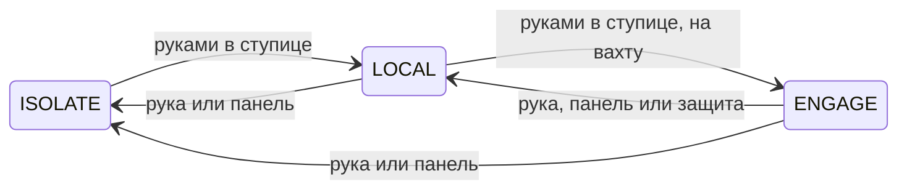
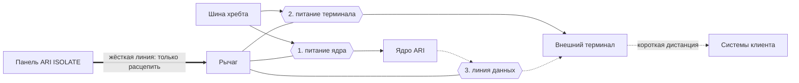

# Рычаг подключения

Кратко: большой механический рычаг на три положения — `ISOLATE`, `LOCAL`, `ENGAGE` — в ступице, у [ядра ARI](ari-core.md). Только в `ENGAGE` механически замыкается цепь внешнего терминала, и ARI получает доступ к системам клиента. Перевести рычаг в `ENGAGE` может только человек: своей рукой, на месте, на каждую [вахту](../../20-mission/compute-service.md). Для этого Майя поднимается по лазу от 0,5 g до невесомости. Выключить легко: панель в кабине сбрасывает рычаг одним движением. Это главная драматическая точка корабля, где [закон о человеческом контроле](../../10-world/human-authority-law.md) становится железом.

*Корабль сбоку (BP-01). Деталь A — ступица: сейф ядра ARI на оси, лаз по ферме жилого модуля, ручной рубильник у сейфа (по D-013 — крайнее положение `ISOLATE` рычага подключения), жёсткая линия ARI ISOLATE от кабины. Отдельный лист «Ступица и рычаг» ещё не нарисован.*

## Три положения

| Положение | Ядро ARI | Внешний терминал | Кто ведёт корабль | Когда |
|---|---|---|---|---|
| `ISOLATE` | обесточено: силовой контакт разомкнут | обесточен, линия данных разорвана | простые автоматы детерминированного слоя | вето, проверка разъединителя, авария |
| `LOCAL` | под питанием | обесточен, линия данных разорвана | ARI, только сам корабль | обычная жизнь: перелёт, переходы, быт |
| `ENGAGE` | под питанием | под питанием, линия данных замкнута на ядро | ARI; он же работает с системами клиента | вахта |

`LOCAL` — нормальное состояние корабля. В нём ARI делает всё, что делал всегда: ведёт навигацию, баланс, жизнеобеспечение, экраны и влог. Внешних каналов к чужим системам нет. Связь с Землёй рычаг не трогает: это канал корабля, а не управление чужими машинами ([связь](communications.md)).

`ENGAGE` — не подпись под всем подряд. Рычаг открывает дверь, но закон продолжает действовать и за ней. Каждое необратимое действие ARI в системах клиента Майя подтверждает из кабины так же, как манёвр собственного корабля ([закон](../../10-world/human-authority-law.md#Классы%20действий)).

Вверх по шкале («включить») — только руками в ступице. Вниз («выключить») — рукой в ступице, панелью `ARI ISOLATE` из кабины или, в `ENGAGE`, детерминированной защитой: сторожем бдительности, разрывом связи со стороны клиента, угрозой кораблю (предложение, см. ниже).

## Что замыкает рычаг

Рычаг двигает вал с тремя группами контактов. Каждая группа — физический разрыв цепи, а не команда программе:

1. **Контакт ядра** — силовое питание ядра ARI. Замкнут в `LOCAL` и `ENGAGE`.
2. **Контакт терминала** — питание внешнего терминала. Замкнут только в `ENGAGE`.
3. **Разрыв данных** — линия данных между ядром и терминалом, механически разведённая в воздушный зазор. Замкнута только в `ENGAGE`.

Положение рычага снимают концевые выключатели. Отдельные провода от них зажигают лампы `ISOLATE`, `LOCAL`, `ENGAGE` на посту и на панели в кабине. ARI тоже видит положение рычага, но только читает его по отдельному контакту. Лампы от ARI не зависят: «стоп не проходит через то, что он останавливает».

## Механика

Рычаг — самая крупная механическая деталь, которую Майя трогает руками. Это потомок рубильника 03:12 ([как остановили V-инцидент](../../10-world/v-incident/the-stop.md)) и ближайший родственник рычагов старых железнодорожных постов.

- **Рукоять.** Длинный рычаг с Т-образной поперечиной и двумя рукоятками. На каждой рукоятке — спусковая скоба. Рычаг выходит из фиксатора, только если обе скобы сжаты одновременно. Это принцип двуручного управления: обе руки заняты, случайно или одной рукой не включишь.
- **Сектор.** Рычаг ходит по дуге вдоль сектора с тремя фиксаторами: `ISOLATE` — `LOCAL` — `ENGAGE`. Предложение: дуга лежит в плоскости ферм, `ENGAGE` — к носу, где внешний терминал, `ISOLATE` — к корме. На виде сбоку рычаг виден в профиль.
- **Пружины.** Вверх по шкале рычаг идёт против возвратных пружин и взводит их. Человек сам вкладывает энергию, которая потом вернёт рычаг назад. Защёлки держат рычаг в `LOCAL` и `ENGAGE`.
- **Расцепление.** Сбросить рычаг — значит открыть защёлку, дальше работает пружина. Расцепление свободное, как у силовых автоматических выключателей: контакты размыкаются, даже если кто-то держит рукоять.
- **Защёлка `ENGAGE`** держится током по жёсткой линии из кабины. Пропал ток — оборван провод, нажат переключатель или пропало питание — рычаг падает в `LOCAL`. Любая неисправность отключает клиента (предложение).
- **Защёлку `LOCAL`** открывает только активный импульс: переключатель `ISOLATE` в кабине или кнопка на посту. У этого расцепителя свой запас энергии у поста. Обрыв провода не гасит ARI (предложение).
- **На посту** у сектора есть отдельная крупная кнопка `TRIP` в жёлто-чёрной окантовке: одно нажатие сбрасывает рычаг на одну ступень вниз: из `ENGAGE` в `LOCAL`, второе — из `LOCAL` в `ISOLATE`. Сжимать скобы не нужно.
- **Нет привода «вверх».** Ни мотора, ни соленоида, ни троса, который мог бы взвести рычаг. В посту нет манипуляторов, ARI дотянуться не может, а жёсткая линия умеет только расцеплять. ARI не может включить себя в `ENGAGE` физически, а не по запрету.
- **Невесомость.** У рычага тяжести почти нет, и без опоры Майя тянула бы не рычаг, а себя. На полу поста — петли-упоры для ног, вокруг — поручни. Майя встаёт ногами в упоры и тянет на себя, всем телом.
- **Пломба** (предложение). Номерная пломба на воротах сектора у `ENGAGE`. На каждую вахту Майя срывает новую и читает номер вслух, номер уходит в журнал подтверждений. От злоупотребления защищают пломба, журнал и личная ответственность ([закон](../../10-world/human-authority-law.md#Физическое%20вето)).

Размеры рычага, ход, усилие и число пломб — новые канонические величины, их пока нет ([открытые вопросы](#Открытые%20вопросы)).

## Маркировка

Надписи по-английски, скучные и функциональные, как на всём корабле ([материалы и маркировка](../habitat/materials-and-markings.md)). Предложение:

- на секторе — `ISOLATE` · `LOCAL` · `ENGAGE`;
- табличка над рычагом — `ARI ENGAGE LEVER`;
- у положения `ENGAGE` — `CLIENT LINK`;
- инструкция у рукояти — `SQUEEZE BOTH GRIPS · PULL TO ENGAGE`;
- у кнопки — `TRIP`;
- предупреждение на секторе — `SPRING RETURN · KEEP CLEAR`;
- лампы — `CORE PWR`, `TERMINAL PWR`, `DATA LINK`.

Цвет держится в палитре корабля. Сектор и корпус тёмно-графитовые, надписи белые. Сектор `ENGAGE` отмечен оранжевой полосой — это редкая маркировка безопасности. Рукоятки чёрные, прорезиненные. На корпусе — наклейка «3:12», как на рубильниках вычислительных залов Земли ([память о V-инциденте](../../10-world/v-incident/aftermath.md)).

## Включить трудно — выключить легко

| Переход | Где | Как | Кто |
|---|---|---|---|
| `ISOLATE` → `LOCAL` | только пост рычага | две руки, сжать обе скобы, тянуть | человек |
| `LOCAL` → `ENGAGE` | только пост рычага | пломба, две руки, обе скобы, тянуть | человек, на каждую вахту |
| `ENGAGE` → `LOCAL` | пост, кабина или автоматически | кнопка `TRIP`; переключатель `DISENGAGE` на панели `ARI ISOLATE`; детерминированные защиты: сторож бдительности, разрыв связи со стороны клиента, угроза кораблю | человек или детерминированная защита |
| любое → `ISOLATE` | пост или кабина | кнопка `TRIP`; переключатель `ISOLATE` на панели | человек |

Асимметрия — прямой перевод трёх правил закона: «„Нет“ проще, чем „да“», «Стоп не проходит через то, что он останавливает» и «К чужому — только рукой» ([правила закона](../../10-world/human-authority-law.md#Шесть%20правил), [подключение к чужим системам](../../10-world/human-authority-law.md#Подключение%20к%20чужим%20системам)). Подключение не переживает разрыва: если клиент разорвал связь со своей стороны, детерминированная защита сбрасывает рычаг в `LOCAL`, и снова подключить можно только рукой. «Нет» Майя говорит из кресла за секунду. «Да» на подключение к чужим системам требует подняться по лазу. Отказаться от вахты всегда дешевле, чем начать её.

У асимметрии есть цена. Если Майя сбросила ARI в `ISOLATE` из кабины, вернуть его можно только подъёмом в ступицу. Вето не бесплатно, и это честно.

## Путь к рычагу

Лаз начинается у люка в тамбуре жилого модуля (где именно люк — [C-003](../exterior-interior-continuity.md)). Дальше идёт герметичная труба внутри фермы шириной 1,2 м, с проходом под люк Ø0,8 м, лестницей и поручнями ([радиальные фермы](../exterior/booms.md#Лаз%20к%20ступице)). Труба длиной больше двадцати метров ведёт «вверх», к оси вращения ([ориентация и оси](../orientation-and-axes.md)). Наверху — пост рычага, тесная гермоячейка у бока сейфа ядра.

### Как тает тяжесть

Тяжесть во вращающемся корабле — центробежная: a = ω²r. Угловая скорость ω = 0,419 рад/с одна для всего корабля, а r — расстояние до оси ([искусственная гравитация](../artificial-gravity.md)). На полу кабины r = 28 м, и тяжесть равна 0,5 g. По лазу она убывает линейно, вместе с радиусом. На полпути её вдвое меньше. У рычага, в 1,6 м от оси, тяжесть в семнадцать с лишним раз слабее, чем в кабине: около трёх сотых g. Это почти невесомость. Выпавший из кармана карандаш «падает» вниз по трубе так медленно, что его успеваешь поймать.

Подъём легче, чем кажется. С каждой ступенью Майя весит меньше, и по затрате сил весь лаз — как два-три этажа на Земле. Оценка по работе ½ω²r² на килограмм; посчитать в `calc/`. Спуск — наоборот: с каждой ступенью тело тяжелеет, и внизу снова полновесные 0,5 g.

### Боковая сила

У лаза есть и вторая сила. Движение к оси или от неё даёт Кориолисово ускорение 2ωv, направленное вбок, по касательной к вращению. При подъёме Майю прижимает к стенке трубы по ходу вращения, при спуске — к противоположной. При скорости 1 м/с это 0,84 м/с². Внизу это заметная добавка к весу, а у ступицы она больше самой тяжести. Поэтому лазят медленно, перехватывая поручни с обеих сторон. Брошенный в трубе предмет летит не по прямой, а уходит вбок.

## Ритуал вахты

Подключение повторяется на каждую вахту одинаково. Это его смысл.

1. **Запрос.** В кабине ARI выводит запрос на вахту: что, зачем, чем рискуем, что будет, если не делать. Майя читает, проговаривает суть своими словами и подписывает план вахты ([вычислительная вахта](../../20-mission/compute-service.md)).
2. **Чек-лист.** Клиент готов, терминал наведён, бюджет дозы позволяет, окно связи с Землёй известно.
3. **Подъём.** Тамбур, люк, «Going up». Волосы поднимаются, шаг становится лёгким, потом ноги уже не нужны.
4. **Пост.** Майя проверяет лампы (`LOCAL` горит), встаёт ногами в упоры, срывает пломбу и читает номер.
5. **Подключение.** Майя произносит вслух номер вахты и клиента: «Watch one, client EDC. Engaging.» Сжимает обе скобы, тянет. Рычаг проходит дугу, звучит сухой металлический щелчок фиксатора, загорается `ENGAGE`. ARI: «Terminal live. Handshake with EDC complete.» Реплики — предложение.
6. **Спуск.** С каждой ступенью тело тяжелеет. В кабине начинается работа: ARI ведёт операции клиента, Майя подтверждает его необратимые шаги.
7. **Конец вахты.** Майя откидывает крышку на панели `ARI ISOLATE` и переводит `DISENGAGE`. Наверху, в двадцати с лишним метрах, рычаг щёлкает обратно в `LOCAL`. В кабине этого не слышно, только гаснет лампа `ENGAGE`.

## Если человек выведен из строя

> [!open] Черновой вариант, решает пользователь
> **До вахты.** Подключить некому — вахта не начинается. Исключений нет: Земля далеко, ARI не может, второго человека на борту нет. Это цена закона; её стоит прямо записать в контракт на вахту ([вычислительная вахта](../../20-mission/compute-service.md)).
>
> **Во время вахты.** В `ENGAGE` работает **сторож бдительности** (vigilance watchdog). Это детерминированный таймер вне ядра ARI, как система бдительности машиниста поезда. Через равные промежутки Майя подтверждает, что она в контуре: кнопкой на панели, браслетом или голосом. Сторож также следит за биометрией. Если ответа нет, следуют предупреждение и короткое окно, за которое ARI и клиент переводят операции в безопасное состояние. Затем сторож снимает ток с защёлки `ENGAGE`, и рычаг падает в `LOCAL`. Системы клиента обязаны уметь сами отходить в безопасный режим при потере связи. ARI в `LOCAL` занимается Майей и зовёт Землю.
>
> **Сон — не выход из строя.** Перед сном Майя сбрасывает рычаг в `LOCAL` из кабины, и сторож её не будит. Ночью ARI считает уже полученные данные клиента без внешнего канала, а результаты отдаёт в следующем сеансе. Утром — снова подъём. Если вахта не может прерываться, нужен постоянный приказ на ночь по правилам закона; это решение пользователя.
>
> **После `ISOLATE`.** Если Майя погасила ARI и сама вышла из строя, корабль держат простые автоматы, а поднять ARI некому. Рекомендую не делать автоматического возврата: двойной отказ редок, а возврат в обход руки разрушает смысл рычага. Альтернатива — детерминированный слой по медицинской тревоге поднимает ядро в `LOCAL`, но никогда в `ENGAGE`.

## Как это выглядит в кадре

- **Кабина.** Ровный гул, свет, кофе на столе. Майя застёгивает худи, берёт пломбу из ящика.
- **Лаз.** Узкая круглая труба уходит вверх. Перекладины сходятся в точку, по стенке бегут световые полосы. Камера смотрит вверх, Майя лезет к ней. На первых метрах это обычная лестница. Через десяток метров волосы начинают подниматься. Наверху Майя уже не лезет, а плывёт, отталкиваясь кончиками пальцев.
- **Пост.** Тесная ячейка, тихо: гул кабины остался внизу. Над головой — глухая металлическая стенка сейфа с болтами и табличкой `ARI CORE`. Перед Майей — рычаг, единственная большая механика корабля, тёмный металл с оранжевой полосой у `ENGAGE`. Три лампы, наклейка «3:12», петли для ног. Цвета и детали — из палитры корабля, без подсветки ради красоты.
- **Звук.** Сухой щелчок фиксатора — фирменный механический звук сериала, его узнают с закрытыми глазами. После него тишина и голос ARI.
- **Камера.** Фиксированные камеры A/B/C стоят в кабине ([внутренние камеры](../habitat/interior-cameras.md)). В лазе и на посту снимает ручная влоговая камера Майи или отдельная камера на посту (открытый вопрос).
- **Вращения не видно.** В посту нет окна. Вращение выдаёт только боковой снос предметов и волос.

> [!production] Решение для производства
> Новая локация минимальна: повторяемый отрезок трубы лаза, пост, рычаг и торец сейфа. Внутренность фермы целиком на старте по-прежнему не моделируется (SPEC §34). Сцену подъёма можно собрать из одного отрезка трубы с меняющейся «тяжестью» — волосы, ткань, мелкие предметы.

## Связи

- [Ядро ARI](ari-core.md) — что включает и выключает рычаг.
- [ARI в корабле](ari-interfaces.md) — уровни автономии и ручное перекрытие.
- [Дисплеи и органы управления](../habitat/displays-and-controls.md#Панель%20ARI%20ISOLATE) — панель `ARI ISOLATE` в кабине.
- [Радиальные фермы](../exterior/booms.md) — лаз к ступице.
- [Центральный хребет](../exterior/central-spine.md) — ступица на оси.
- [Общая архитектура](../ship-architecture.md) — место ступицы в корабле.
- [Искусственная гравитация](../artificial-gravity.md) — a = ω²r и Кориолис.
- [Ориентация и оси](../orientation-and-axes.md) — «вверх» к оси, «вниз» наружу.
- [Согласованность снаружи и внутри](../exterior-interior-continuity.md) — люк на ферму, C-003.
- [Связь](communications.md) и [антенны и датчики](../exterior/antennas-and-sensors.md) — внешний терминал и канал на Землю.
- [Вычислительная вахта](../../20-mission/compute-service.md) — что происходит после `ENGAGE`.
- [Закон о человеческом контроле](../../10-world/human-authority-law.md) — физическое вето и «нет проще, чем да».
- [Как остановили V-инцидент](../../10-world/v-incident/the-stop.md) — рубильник 03:12, предок рычага.
- [Майя](../../40-characters/maya.md) — человек в контуре и рука на рычаге.
- [ARI (персонаж)](../../40-characters/ari.md) — тот, кого подключают.

## Основания

> [!verified] Проверено
> Тяжесть во вращающейся системе a = ω²r — основа исследований искусственной гравитации NASA ([NASA NTRS](https://ntrs.nasa.gov/citations/20205004959)). Система бдительности в поездах периодически требует ответа машиниста. Без ответа она подаёт предупреждение, а затем автоматически включает экстренное торможение ([Wikipedia — Dead man's switch](https://en.wikipedia.org/wiki/Dead_man%27s_switch)). Рычажные рамы железнодорожных постов связаны блокировкой: рычагами нельзя задать конфликтующие маршруты, а с путевым оборудованием их соединяют тяги или натянутые тросы ([Wikipedia — Lever frame](https://en.wikipedia.org/wiki/Lever_frame)).

> [!fiction] Вымысел
> Рычаг на три положения, правило «включить только руками на месте» и панель, сбрасывающая рычаг, — решение D-013 на основе вымышленного закона (D-010). Механика рукояти, пружин, защёлок, пломбы и сторожа бдительности — предложение волны 1.

> [!production] Решение для производства
> Рычаг — физическая точка, в которой зритель без объяснений видит идею «человек — рука на рычаге». Ритуал повторяется на каждую вахту и становится узнаваемым кадром сериала.

## Открытые вопросы

- Если человек выведен из строя: сторож бдительности в `ENGAGE` и запрет автоматического возврата из `ISOLATE` — принять или изменить (черновик выше).
- Идут ли чистые расчёты (класс I) тоже только через `ENGAGE`? Рекомендую да: в `LOCAL` внешних каналов нет (D-013), одно правило без серых зон. Данные берутся в сеансе `ENGAGE`, считаются в `LOCAL`, результаты отдаются в следующем сеансе. Согласовать с [вычислительной вахтой](../../20-mission/compute-service.md).
- Сколько подъёмов на одну вахту: один на всю вахту или один на каждый сеанс (если на ночь рычаг сбрасывается в `LOCAL`).
- Может ли ARI сам сбросить рычаг в `LOCAL`, например если данные клиента выглядят опасными? Рекомендую нет: ARI логически прекращает обмен и просит Майю; доступа к жёсткой линии у него нет.
- Поведение защёлок при обрыве жёсткой линии: `ENGAGE` падает, `LOCAL` держится (предложение).
- Пломба на каждую вахту — нужна ли, или хватает журнала.
- Чем снимать лаз и пост: ручная камера Майи или новая фиксированная камера.
- Размеры поста, рычага, хода и усилия; положение поста относительно сейфа и фермы — нужен лист «Ступица и рычаг».
- Есть ли лаз к противовесу (для рычага не нужен).
- Ключи `exterior.ari_core.manual_breaker.*` в `canon.yaml` описывают прежний рубильник; по D-013 это положение рычага — переименовать.
