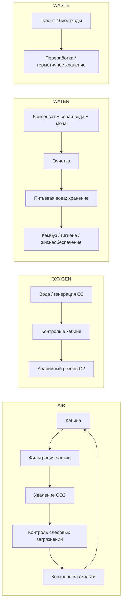

# Жизнеобеспечение (ECLSS)

Кратко: набор обслуживаемых блоков размером с бытовой прибор, которые поддерживают воздух, кислород, влажность, воду и мониторинг среды в жилом модуле. Физически это сервисная стена СЖО у кормового торца кабины; логически — несколько связанных контуров: воздух, кислород, вода, отходы, мониторинг.

Эта страница описывает систему; саму стену как часть интерьера описывает [Сервисная стена СЖО](../habitat/service-wall.md).

## Функциональные блоки (SPEC §12)

Эта стена делает корабль правдоподобным. Нельзя прятать всё жизнеобеспечение за магическими панелями: хотя бы часть фильтров, дверей доступа, надписей и точек обслуживания должна быть видна.

**Циркуляция воздуха**
- вентиляторы циркуляции;
- решётка возвратного воздуха;
- фильтры твёрдых частиц;
- сменные картриджи фильтров.

**Удаление CO2**
- регенерируемый блок CO2-скруббера;
- аварийные запасные картриджи.

**Контроль следовых загрязнений**
- секция фильтра / каталитической обработки.

**Управление кислородом**
- блок генерации кислорода;
- аварийный резерв кислорода высокого давления.

**Контроль влажности**
- конденсатор;
- сбор конденсата.

**Восстановление воды**
- сбор серой воды;
- возврат конденсата влажности;
- подключение переработки мочи;
- очистка воды;
- бак питьевой воды.

**Мониторинг кабины** — датчики:
- давления;
- кислорода;
- углекислого газа;
- влажности;
- температуры;
- дыма / продуктов горения.

## Правило визуального дизайна

Система должна выглядеть как несколько обслуживаемых модулей размером с бытовой прибор, а не как один необъяснимый светящийся ящик. Майя должна получить съёмные фильтры, картриджи и смотровые крышки, с которыми можно взаимодействовать в будущих эпизодах.

Примеры подписей на оборудовании (SPEC §28): `AIR RETURN`, `FILTER A`, `POTABLE H2O`, `SERVICE ACCESS`, `EMERGENCY O2`, `BUS B`, `CABIN FAN 2`, `WASTE PROC`, `MANUAL RELEASE`. Большинство подписей должно быть скучными.

## Функциональная схема (PROMPTS 07)

Контуры:

- **AIR:** кабина → фильтрация частиц → удаление CO2 → контроль следовых загрязнений → контроль влажности → кабина.
- **OXYGEN:** вода / генерация O2 → контроль в кабине → аварийный резерв O2.
- **WATER:** конденсат влаги + серая вода + переработка мочи → очистка → хранилище питьевой воды → камбуз / гигиена / жизнеобеспечение.
- **WASTE:** туалет / биологические отходы → переработка / герметичное хранение.
- **MONITORING:** давление, O2, CO2, влажность, температура, дым.

Обслуживаемые фильтры должны быть доступны из жилого модуля.

## Где что находится

- Сервисная стена СЖО — у кормового торца кабины, ниже блока гигиены и укрытия на плане (SPEC §5; [Планировка](../habitat/interior-layout.md)).
- Датчики давления, кислорода, CO2, воды выводятся на постоянную статусную строку и на экран «life-support status» ([дисплеи и органы управления](../habitat/displays-and-controls.md), [экранные шаблоны](../../70-series/screen-templates.md)).
- Физический орган «life-support override» — ручное перекрытие (SPEC §6).
- Вне кабины: большая часть запасной техники, мощные преобразователи (SPEC §31); баки воды — в нескольких местах ([Вода](water.md)).
- Обслуживание: снять панель, диагностировать заменяемый модуль, заменить, запустить тест ARI (SPEC §23); запасные фильтры и вентилятор лежат в ремонтной системе ящиков ([Инструменты и ремонт](../habitat/tools-and-repair.md)).
- Санузел использует контролируемый воздушный поток / вакуумную помощь и закрытую обработку отходов (SPEC §10; [Санузел](../habitat/hygiene.md)).

## Что раскрыть при углублении

- Балансы на человека и сутки: потребление O2, выработка CO2, влаги, вода; источники (NASA ECLSS) и пересчёт на одного человека (в исходниках чисел нет).
- Замкнутость контуров: что регенерируется, что расходуется (картриджи, фильтры), запасы расходников; связь с [хранением](../habitat/storage.md).
- Аварийный режим: аварийный запас кислорода и CO2-картриджи, длительность, как это согласуется с «без аварийных сцен» в сезоне 1.
- Работа в 0,5 g: естественная конвекция, расположение конденсатора и сборников, слив воды, сепарация газов; опора на реальные системы МКС и вывод, что меняется при гравитации.
- Схема и чертёж по PROMPTS 07 с номерами; рисунок сервисной стены.
- Тепло от СЖО на радиаторы ([терморегулирование](thermal-control.md)).

## Связи

- [Сервисная стена СЖО](../habitat/service-wall.md) — физическая стена, где стоят модули.
- [Вода](water.md) — водный контур, баки и рециркуляция.
- [Терморегулирование](thermal-control.md) — тепло оборудования СЖО.
- [Дисплеи и органы управления](../habitat/displays-and-controls.md) — статусная строка, физический орган «life-support override».
- [Инструменты и ремонт](../habitat/tools-and-repair.md) — замена модулей и фильтров.
- [Санузел](../habitat/hygiene.md) — приёмник отходов и воды.
- [ARI в корабле](ari-interfaces.md) — ARI постоянно отслеживает кабину.
- [Стазис](../../20-mission/stasis.md) — режим работы систем, пока Майя в стазисе.

## Основания

> [!verified] Проверено
> NASA описывает регенерацию воздуха, генерацию кислорода, восстановление воды, обращение с отходами и мониторинг среды как основные функции жизнеобеспечения космических аппаратов. ESA независимо описывает системы регенерации воздуха (удаление CO2 и следовых загрязнений) и системы восстановления воды (переработка мочи, пота и гигиенической воды). Источники: NASA — Environmental Control and Life Support Systems (ECLSS), https://www.nasa.gov/reference/environmental-control-and-life-support-systems-eclss/ ; ESA — Air Revitalization System, https://www.esa.int/content/view/full/194826 ; ESA — Water Recovery System Racks, https://www.esa.int/Science_Exploration/Human_and_Robotic_Exploration/Node-3_Cupola/Water_Recovery_System_Racks (sources/maya_ari_ship_3d_build_spec.md §38).

> [!fiction] Вымысел
> Бортовой ИИ ARI, непрерывно следящий за кабиной, и предлагаемые компактные системы вроде душа и стирки — допущения мира (SPEC §39).

> [!production] Решение для производства
> Правило видимости: жизнеобеспечение должно быть видно как набор обслуживаемых модулей с фильтрами, картриджами и надписями; Майя взаимодействует с ними (SPEC §12). Допущение дизайна: ARI управляет почти всеми рутинными функциями, Майя может вручную перекрывать критичные для безопасности системы (SPEC §40).

## Открытые вопросы

- Нужна ли точная схема связности контуров на странице (кто что питает) или хватает функциональной.
- Положение «emergency O2» в кабине.
- Работает ли система одинаково в стазисе (расход воздуха при спящей Майе).
