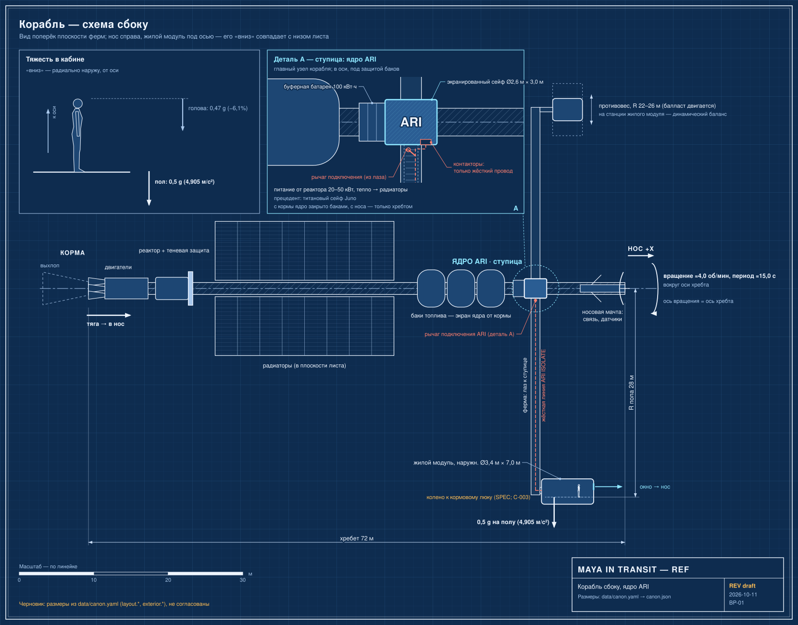

# Навигация, ориентация и управление вращением

Кратко: набор функций, которые держат корабль на траектории, поддерживают его ориентацию, скорость вращения и баланс масс. В исходниках об этом сказано мало: допущение для производства о снижении вращения при крупных манёврах, автоматический баланс под управлением ARI и несколько дисплеев и камер для навигации. Всё остальное — предмет волны 2.

*Корабль сбоку (BP-01). Нос справа, корма слева, ось вращения идёт по хребту. Жилой модуль висит на ферме под осью, противовес — напротив, на той же станции. Вдоль хребта от кормы: двигатели, реактор с теневой защитой, радиаторы, баки, ступица с ядром ARI, носовая мачта связи.*

## Что сказано в исходниках

- Допущение для производства: для крупных изменений ориентации аппарат может снижать скорость вращения; осевую крейсерскую тягу в вымышленной конструкции можно считать совместимой с вращением; в ранних эпизодах это показывать не нужно (SPEC §1.1; допущение дизайна SPEC §40: большие смены ориентации возможны при сниженном вращении).
- Нормальное вращение — около 4 об/мин, гравитация на полу зафиксирована на 0,5 g (SPEC §40; [Искусственная гравитация](../artificial-gravity.md)).
- ARI автоматически управляет балансом вращающегося аппарата по мере перемещения расходных запасов; точное балансировочное оборудование — допущение дизайна (SPEC §32; [Служебный модуль](../exterior/service-pod.md)).
- Основной дисплей показывает траекторию и навигацию; вторичный — состояние корабля и таймеры; статусная строка — «acceleration state», «spin / gravity status», «next manoeuvre» (SPEC §6; [Дисплеи и органы управления](../habitat/displays-and-controls.md)).
- Внешняя камера «forward navigation» (SPEC §26; [Антенны, датчики и камеры](../exterior/antennas-and-sensors.md)).
- ARI подключён к навигации и управлению двигателями (PROMPTS 12; [ARI в корабле](ari-interfaces.md)).
- Шаблоны экранов: «orbital map» и другие (SPEC §36; [Экранные шаблоны](../../70-series/screen-templates.md)).
- Орган «manual propulsion inhibit» (SPEC §6; [Двигательная установка](../exterior/propulsion.md)).
- Траектория: до дальнейших расчётов все числа (расстояния, скорости, высоты, периоды, даты) — под правилом «не придумывать» (CONCEPT «Important realism rule»); конкретной траектории нет ([Перелёт к Юпитеру](../../20-mission/interplanetary-cruise.md), [Тур по системе Юпитера](../../20-mission/jovian-tour.md)).

## Функции системы

Перечень функций, которые следуют из исходников; конкретное железо в них не названо:

| Функция | Источник | Железо |
|---|---|---|
| Поддержание скорости вращения (около 4 об/мин, 0,5 g) | SPEC §40 | не задано |
| Снижение вращения для крупных манёвров, последующая раскрутка | SPEC §1.1, §40 | не задано |
| Баланс масс по мере расхода запасов | SPEC §32 | «подвижный балласт» (PROMPTS 15) — допущение |
| Ориентация оси вращения / тяги в пространстве | SPEC §1.1 | не задано |
| Осевая тяга для коррекции траектории | SPEC §1.1 | [двигательная установка](../exterior/propulsion.md) |
| Навигационные датчики и камеры | SPEC §1, §26 | [датчики](../exterior/antennas-and-sensors.md) |

## Почему снижение вращения упрощает смену ориентации

Вращающееся тело обладает угловым моментом L = Iω; чтобы повернуть ось вращения, нужен момент, пропорциональный L, поэтому при меньших оборотах для поворота нужен меньший момент. Это объясняет, зачем в SPEC допущение о снижении вращения для крупных манёвров (вывод, не утверждение исходников). Цена: гравитация в кабине пропорциональна ω² ([Искусственная гравитация](../artificial-gravity.md#расчёт)), то есть при сниженных оборотах пол становится легче.

## Что раскрыть при углублении

- Режимы вращения: нормальный (около 4 об/мин), сниженный, остановленный; время раскрутки и торможения; чем создаётся и гасится вращение (двигатели ориентации, маховики) — в исходниках не задано.
- Управление балансом: как ARI определяет смещение центра масс и перемещает балласт; допустимая несбалансированность.
- Ориентация при тяге и торможении: при осевой тяге у Юпитера нужна переориентация корабля; куда смотрит окно ([Ориентация и оси](../orientation-and-axes.md)).
- Навигационные датчики и их монтаж на вращающемся корабле ([Антенны, датчики и камеры](../exterior/antennas-and-sensors.md)).
- Связь с траекторией: после расчёта тура ([Тур по системе Юпитера](../../20-mission/jovian-tour.md), [Гравитационный манёвр](../../50-science/gravity-assist.md)) — что именно отображается на экранах навигации.
- Что остаётся ручным: «manual propulsion inhibit», ручное перекрытие критичных систем ([ARI в корабле](ari-interfaces.md)).

## Связи

- [Искусственная гравитация](../artificial-gravity.md) — вращение, обороты, снижение оборотов.
- [Служебный модуль](../exterior/service-pod.md) — балансировка.
- [Двигательная установка и баки](../exterior/propulsion.md) — осевая тяга.
- [ARI в корабле](ari-interfaces.md) — ARI управляет балансом и навигацией.
- [Перелёт к Юпитеру](../../20-mission/interplanetary-cruise.md) — траектория (пока не рассчитана).
- [Тур по системе Юпитера](../../20-mission/jovian-tour.md) — петли и гравманёвры.
- [Ориентация и оси](../orientation-and-axes.md) — система координат, направление окна.

## Основания

> [!fiction] Вымысел
> Корабль с осевой тягой при общем вращении и бортовой ИИ ARI, управляющий балансом, не подтверждены сегодняшними возможностями (SPEC §39).

> [!production] Решение для производства
> Допущение: большие смены ориентации выполняются при сниженном вращении, осевая тяга совместима с вращением; в ранних эпизодах не показывается (SPEC §1.1, §40). Баланс управляется ARI автоматически; точное железо — допущение дизайна (SPEC §32).

## Открытые вопросы

- Чем создаётся и гасится вращение; как делается баланс.
- Как проходит переориентация корабля при торможении у Юпитера.
- Показываем ли зрителю переход на сниженное вращение хоть раз.
