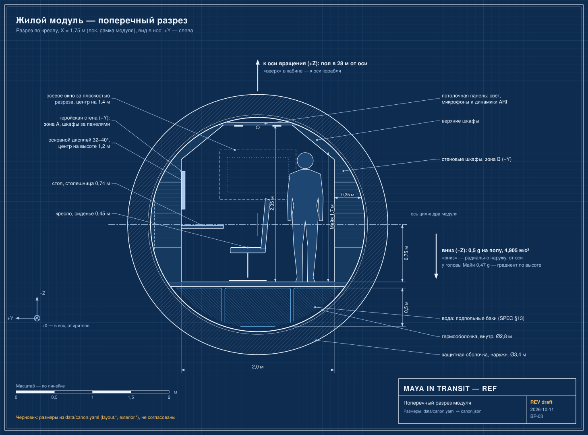
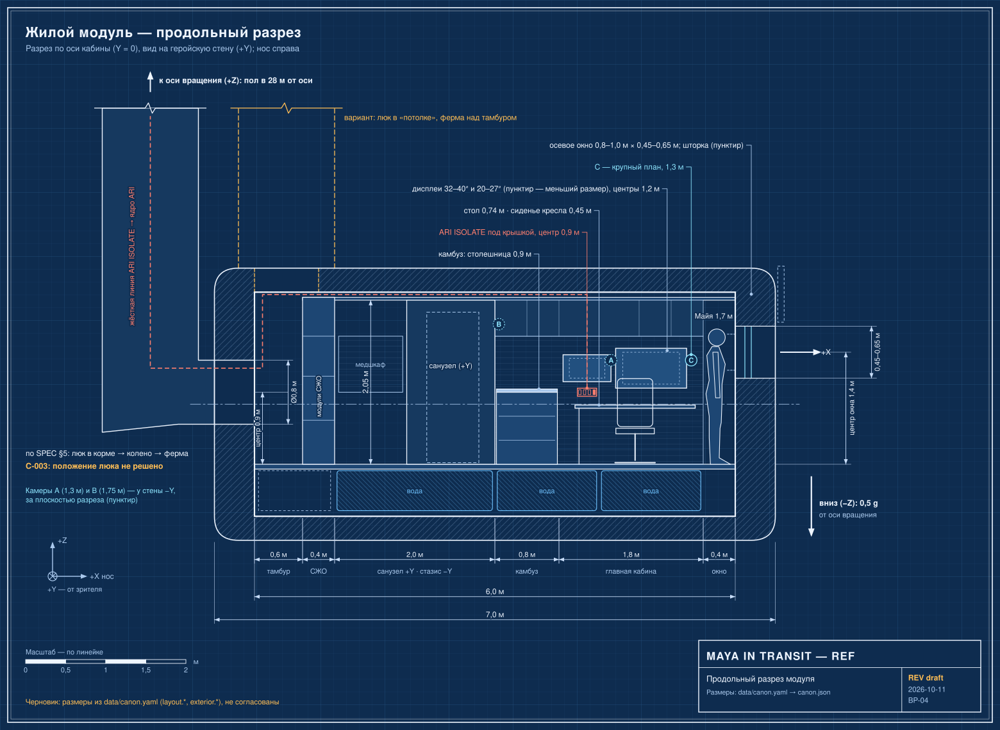

# Вода

Кратко: вода — одна из самых полезных масс на корабле: питьевая, гигиеническая, для кислорода и как защита от радиации. Её не держат в одном баке, а распределяют вокруг укрытия, у кормовой стены оборудования и в полу и структурных полостях — ради баланса, избыточности, защиты и удобной упаковки.

*Поперечный разрез через главную кабину (BP-03). Гермо- и защитная оболочки, пол ниже оси цилиндра, подпольные баки воды, шкафы, высота потолка, Майя в рост. «Вниз» — радиально наружу, «вверх» — к оси вращения.*

*Продольный разрез жилого модуля (BP-04). Окно в носу, зоны и высоты по длине, подпольные баки воды, тамбур и люк к ферме с вариантом C-003, жёсткая линия ARI ISOLATE к ферме.*

## Баки

Не помещать всю воду в один бак. Распределять вокруг (SPEC §13):

- зоны стазиса / укрытия;
- кормовой стены оборудования;
- пола и структурных полостей, где это практично.

Причины в вымышленном дизайне:

- баланс;
- избыточность;
- радиационная защита;
- более простая упаковка.

Отдельный водный резерв может находиться в служебном модуле (SPEC §32; [Служебный модуль](../exterior/service-pod.md)). Вокруг стазисного отсека лежат вода и баки сточной воды как защитная масса (SPEC §11; [Радиационная защита](radiation-protection.md)).

## Контур воды

По SPEC §12 и PROMPTS 07 цепочка восстановления воды:

1. сбор серой воды, возврат конденсата влажности, подключение переработки мочи;
2. очистка воды;
3. бак питьевой воды;
4. потребители: камбуз, гигиена, жизнеобеспечение (включая генерацию кислорода).

Потребители и точки выдачи:

- камбуз: диспенсер питьевой воды и выход горячей воды ([Камбуз](../habitat/galley.md));
- санузел: форсунка гигиенической воды, умывальник, при желании — выдвижная лейка для мытья ([Санузел](../habitat/hygiene.md));
- система кислорода: вода как источник O2 (PROMPTS 07: «water / O2 generation»; [Жизнеобеспечение](life-support.md)).

На статусной строке постоянно виден запас воды («water reserve», SPEC §6; [Дисплеи и органы управления](../habitat/displays-and-controls.md)).

## Видимая сантехника

Видимой должна быть лишь небольшая часть сантехники. Использовать:

- маркированные панели доступа;
- цветовую кодировку служебных линий;
- смотровые порты;
- при желании небольшой прозрачный диагностический участок.

Избегать лесов труб в духе стимпанка. Пример подписи на оборудовании: `POTABLE H2O` (SPEC §28).

## Что раскрыть при углублении

- Объёмы и массы воды: общий запас, суточный расход на человека, замкнутость контура (источники NASA ECLSS, ESA); в исходниках нет ни одного числа.
- Карта баков: сколько, где, какая вода (питьевая, серая, сточная, технологическая), с рисунком по PROMPTS 08.
- Вода как защита: толщина слоя и поглощение; связь с [радиационной защитой](radiation-protection.md) и расчётами в [Юпитерианской радиации](../../50-science/jovian-radiation.md).
- Вода и баланс вращения: перекачка между жилым и служебным модулями, смещение центра масс по мере расхода ([Служебный модуль](../exterior/service-pod.md)).
- Вода при 0,5 g: слив, подача, поведение капель; что можно решать гравитацией, а что насосом.
- Схема водных трасс и точек доступа для кадров обслуживания.

## Связи

- [Жизнеобеспечение](life-support.md) — контур восстановления воды и подготовка питьевой воды.
- [Радиационная защита](radiation-protection.md) — вода как защитная масса вокруг укрытия.
- [Служебный модуль](../exterior/service-pod.md) — водный резерв и баланс.
- [Камбуз](../habitat/galley.md) — диспенсер питьевой воды и горячая вода.
- [Санузел](../habitat/hygiene.md) — гигиеническая вода.
- [Отсек стазиса, сна и укрытия](../habitat/stasis-shelter.md) — вокруг него баки.
- [Хранение](../habitat/storage.md) — другие запасы, которые тоже служат защитной массой.

## Основания

> [!verified] Проверено
> ESA изучало воду как радиационную защиту, а также размещение систем жизнеобеспечения с водосодержащими материалами вокруг защищаемых мест экипажа. ESA независимо описывает системы восстановления воды, перерабатывающие мочу, пот и гигиеническую воду. Источники: ESA — For astronaut radiation protection, just add water, https://www.esa.int/Enabling_Support/Space_Engineering_Technology/For_astronaut_radiation_protection_just_add_water ; ESA — ESA engineers assess Moon Village habitat, https://www.esa.int/Enabling_Support/Space_Engineering_Technology/CDF/ESA_engineers_assess_Moon_Village_habitat ; ESA — Water Recovery System Racks, https://www.esa.int/Science_Exploration/Human_and_Robotic_Exploration/Node-3_Cupola/Water_Recovery_System_Racks (sources/maya_ari_ship_3d_build_spec.md §38).

> [!fiction] Вымысел
> Точная эффективность выбранной раскладки воды и запасов для защиты не определена (SPEC §39).

> [!production] Решение для производства
> Причины распределения воды — баланс, избыточность, защита, упаковка — это допущения вымышленного дизайна (SPEC §13); сантехника скрыта и подписана ради визуальной чистоты.

## Открытые вопросы

- Общий объём воды и разбивка по бакам.
- Сколько воды в служебном модуле и сколько в жилом.
- Как выглядит прозрачный диагностический участок (если он нужен).
