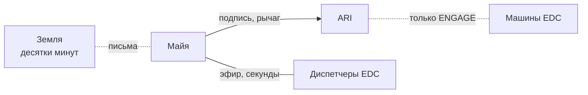

# Персонажи

Кратко: в кадре один человек — Майя — и один голос — ARI. ARI продаёт вычисления и несёт вахты: ведёт корабль, считает чужие задачи, работает с машинами клиента. Майя — сервисный оператор: человек в контуре, рука на рычаге подключения и подпись под каждым опасным решением ARI. Все остальные существуют через связь: Земля — письмами с задержкой в десятки минут, клиент у Европы — голосами почти без задержки. Раздел описывает героиню (кто она, откуда, почему согласилась, как живёт и что носит), бортовой ИИ и людей на связи.

## Состав

| Кто | В кадре | Страница |
|---|---|---|
| Майя | Да — единственный человек на борту, сервисный оператор, автор влога | [Майя](maya.md) |
| ARI | Голос, огонёк статуса, экраны; тела и лица нет; товар Calder и исполнитель вахт | [ARI](ari.md) |
| Люди на Земле | Нет — письма, записи, упоминания | [Люди на связи](mission-control.md) |
| Диспетчеры клиента EDC | Нет — голоса в эфире на вахте | [Люди на связи](mission-control.md#клиент-edc) |

## Страницы раздела

| Страница | Что внутри |
|---|---|
| [Майя](maya.md) | Кто она, сервисный оператор, ритуал вахты, базовые навыки, рассказчица в пути, характер и манера речи |
| [Предыстория Майи](maya-backstory.md) | Откуда она, всё в образование, почему согласилась на вахту, почему выбрали её, три года активного сна |
| [Быт и распорядок](maya-daily-life.md) | Обычный день и день вахты, рутина подтверждений, бюджет дозы, шесть позиций |
| [Одежда и стиль](maya-wardrobe.md) | Бортовая одежда, одежда на вахту, костюм «Гидра», хранение, стирка |
| [ARI](ari.md) | Бортовой ИИ: продавец вычислений и исполнитель вахт, «мог бы и без неё», уровни автономии, рычаг, характер |
| [Люди на связи](mission-control.md) | Земля (центр управления, инструктор, врач, семья) и диспетчеры клиента EDC |

## Правила раздела

- **Один человек в кадре.** Экипаж — одна Майя (SPEC, шапка). Никаких вторых персонажей на борту, пришельцев и визитёров.
- **ARI — не персонаж в теле.** «A very advanced operating system rather than a second physical character» (SPEC §7). В русском тексте — «он».
- **ARI не злодей.** Он спокойно принимает [закон о человеческом контроле](../10-world/human-authority-law.md) и рычаг подключения; отношения Майи и ARI тёплые и рабочие (D-010, D-013).
- **Майя — сервис, не наука.** Она не учёный и не пилот; наука попутная, а рассказывает она о том, что вокруг (D-012).
- **Тон спокойный.** Экономика, из которой уехала Майя, — фон, а не обличение. Смысл названия в сериале не проговаривается (D-015).
- **Без драмы ради драмы.** Конфликты — бытовые и рабочие; никаких катастроф, предательств ИИ, любовных треугольников (CONCEPT, «What we deliberately avoid»).
- **Всё сверх исходников и решений — предложение.** Имена, биографии, семья помечены как вымысел и ждут решения пользователя.

## Что раскрыть при углублении

- Лист образа Майи: визуальные референсы, рост 1,7 м, причёска, канонические комплекты одежды, лист «Гидры».
- Голосовые паспорта Майи и ARI — для озвучки; голоса диспетчеров EDC.
- Решение по развилкам героини (имя, происхождение, специальность, близкие) и запись в [журнал решений](../90-reference/decisions.md).
- Нужны ли отдельные страницы для Аны, семьи и людей EDC, когда биографии вырастут.

## Связи

- [Мир 2050-х](../10-world/index.md) — мир, из которого пришли персонажи.
- [Миссия](../20-mission/index.md) — вахты, которые они несут.
- [Вычислительная вахта](../20-mission/compute-service.md) — работа Майи и ARI.
- [Рычаг подключения](../30-ship/systems/engage-lever.md) — место, где Майя и ARI встречаются физически.
- [Жилой модуль](../30-ship/habitat/index.md) — где Майя живёт.
- [Концепция сериала](../70-series/series-concept.md) — тон, правила для героини и смысл названия.
- [Закон о человеческом контроле](../10-world/human-authority-law.md) — почему на борту ровно один человек.

## Основания

> [!fiction] Вымысел
> Исходники задают одну героиню, бортовой ИИ без тела и рамку характера (CONCEPT, «The character»; SPEC, шапка, §7). Роль человека в контуре — D-010; вахта и сервисный оператор — D-012; рычаг — D-013; активный сон — D-014; мотивация — D-015. Остальное — предложение.

## Открытые вопросы

- Все ключевые развилки героини и ARI собраны на страницах [Майя](maya.md), [предыстория](maya-backstory.md), [ARI](ari.md) и [люди на связи](mission-control.md).
- Где находятся люди EDC — на Земле или в системе Юпитера ([люди на связи](mission-control.md#клиент-edc)).
