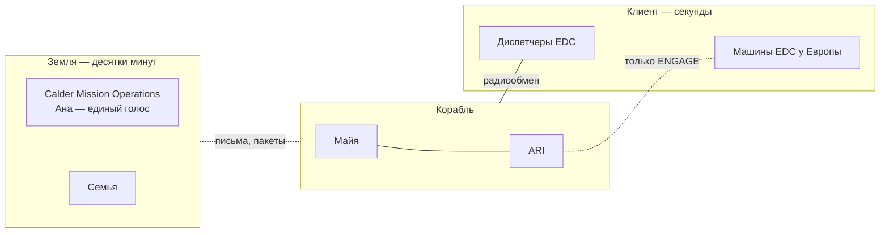

# Люди на связи

Кратко: все люди, с которыми Майя говорит, кроме ARI. Их два круга. **Земля** — центр управления Calder, инструктор, врач, команда ARI, надзор и семья. Сигнал туда идёт ≈33–54 мин в одну сторону, поэтому с Землёй переписываются, а не разговаривают. **Клиент** — диспетчеры Europa Development Consortium (EDC), которые ведут операции у Европы. С ними связь почти без задержки, и это новый для Майи тип собеседника: живой голос, который можно перебить. В кадр не попадает никто: их присутствие — сообщения на экране, голоса в динамике, упоминания в репликах.

## Из исходников

- В эпизоде 6 Майя «answers a message» (CONCEPT, «Episode 6»).
- В статусной строке — «communications delay» (SPEC §6).
- Экранный шаблон «communications message» (SPEC §36; [экранные шаблоны](../70-series/screen-templates.md)).

Больше исходники о людях вне корабля ничего не говорят.

## Два круга

> [!fiction] Вымысел
> Предложение. Клиент и вахта — решение D-012 ([журнал решений](../90-reference/decisions.md)); организации — [организации](../10-world/organizations.md).

| | Земля | Клиент: EDC |
|---|---|---|
| Задержка | десятки минут в одну сторону ([связь с Землёй](../20-mission/earth-link.md)) | секунды |
| Формат | письма, пакеты, видеозаписи | живой радиообмен и разговор |
| Кто | Calder, HMC, JHP, семья | диспетчеры и инженеры операций EDC |
| Что решают | планы, контракт, медицина, разбор журнала постфактум | что делать с их машинами, приоритеты заказов |
| В контуре ARI | нет: слишком далеко | нет: рычаг и подпись — у Майи |
| Отношения | свои: коллеги, друзья, семья | рабочие: клиент и сервис |

## Земля

> [!fiction] Вымысел
> Предложение. Окна связи и задержка — [связь с Землёй](../20-mission/earth-link.md).

### Как работает связь
- **Пакетный режим.** Раз в бортовые сутки приходит пакет: план, ответы, заявки на попутные задачи, письма. Майя отвечает записями. Разговоров вживую нет: вопрос и ответ разделяет двойное световое время.
- **Решения на борту.** Решения готовит ARI, подтверждает Майя. Земля в контур не входит: с задержкой в десятки минут подтверждение в реальном времени невозможно. Земля планирует, ведёт контракт и проверяет потом.
- **Журнал подтверждений.** Каждый запрос ARI и ответ Майи уходят на Землю. Его читают Calder Mission Operations и надзор JHP и иногда пишут ей: «вот здесь мы бы спросили то же самое» или «вот здесь можно было не спрашивать».
- **Один голос.** Как в традиции связных (CAPCOM), вся официальная связь Calder идёт через одного человека, чтобы Майя не тонула в десятке голосов.

### Команды

| Команда | Что делает | Ключевой человек (рабочее имя) |
|---|---|---|
| **Calder Mission Operations** — центр управления полётом и вахтами | Планы, состояние корабля, манёвры, контракт с EDC, разбор журнала | Руководитель полёта **Грейс Уитфилд** (Grace Whitfield) |
| Связной (CAPCOM) | Единый голос Calder; ежедневный пакет | **Ана Ковальская** (Ana Kowalska) — инструктор операторов |
| Медицина (HMC) | Активный сон, восстановление, здоровье, доза, психологическая поддержка | Врач экипажа **Кэндзи Араи** (Kenji Arai) |
| Команда ARI в Calder | Сопровождение ARI, проверка и отправка обновлений | Ведущий инженер **Маркус Фельд** (Marcus Feld) |
| Научный офис JHP (SOC) | Заявки на попутные задачи | Координатор **Ингрид Сольберг** (Ingrid Solberg), геофизик льда |
| Надзор JHP | Допуск к вахте, разбор журнала по закону | — |
| Связи с общественностью Calder | Публикация влога, проверка на тайну клиента, вопросы зрителей ([медиа](../10-world/media-and-audience.md)) | — |

### Ана Ковальская — инструктор и голос Calder
- Ведущий инструктор операторов Calder, сертифицированный оператор с земным стажем. Учила Майю на подготовке, а потом три года вела её обучение в полёте: её записанные уроки Майя смотрела в свой час бодрствования ([предыстория](maya-backstory.md)).
- Экзамены Майе составляла она, а не ARI.
- Теперь — связной: единый голос Calder на борту. Журнал подтверждений Майи она читает первой.
- Подруга Майи. Дружба странная: три года одна говорила, другая слушала и отвечала письмами раз в сутки. Без романтической линии.
- Если Calder отправит второй вычислительный корабль, Ана — первый кандидат в операторы ([дальнейшие этапы](../20-mission/future-arcs.md)).

### Кэндзи Араи — врач экипажа
- Врач консорциума HMC. Вёл Майю на наземных пробах активного сна и все три года перелёта. Знает её физиологию лучше неё самой.
- Еженедельно разбирает данные подкожного датчика и медосмотров, которые Майя проводит с ARI ([медшкаф](../30-ship/habitat/medical.md)). У Европы к этому добавляется её доза ([бюджет дозы](maya-daily-life.md#бюджет-дозы)).

## Клиент: EDC

> [!fiction] Вымысел
> Предложение. Заказчик и вахта — D-012; что продаётся — [вычислительная вахта](../20-mission/compute-service.md).

> [!open] Где находятся люди EDC
> Связь с ними у Европы почти без задержки — значит, это люди в системе Юпитера, а не на Земле. D-012 это допускает: освоение Европы идёт «в основном машинами». Но [организации](../10-world/organizations.md) пока держат операторов EDC на Земле, а Майю — первым человеком у Юпитера. Решение — за пользователем; варианты — в «Открытых вопросах».

### Кто они
- **Диспетчерская смена EDC** — несколько человек, которые ведут кампанию у Европы: грузы, посадки, бурение. Смены меняются, голоса разные.
- **Руководитель операций** — рабочее имя **Нура Халид** (Noura Khalid). Ставит задачи на вахту, утверждает приоритеты со стороны клиента, ругается из-за сроков.
- **Инженеры операций** — буровики, специалисты по грузам и станциям. Звучат в эфире, когда идёт их операция.

### Чем они новые
- **Живой голос.** Впервые за годы Майя говорит с людьми без часовой паузы. Можно перебить, переспросить, засмеяться одновременно. Первая вахта — ещё и первый живой разговор с людьми за весь рейс.
- **Не свои.** Земля — коллеги и семья. EDC — клиент: они платят, торопятся, видят в ней сервис. Для них она «оператор Calder», человек при рычаге. Кто-то уважает её роль, кто-то считает формальностью, которая стоит им минут.
- **Работа вслух.** С клиентом идёт радиообмен по стандартной фразеологии, с проговариванием, как у авиадиспетчеров. Английский, короткие фразы.
- **Кто что решает.** Что делать с их машинами, решает клиент. Как это сделать, предлагает ARI. Можно ли — подписывает Майя. На «давайте быстрее» ARI отвечает: “The operator is reviewing.”
- **Тайна клиента.** Разговоры и данные EDC принадлежат клиенту. Во влог попадает только разрешённое; это проверяют ARI и связи с общественностью Calder ([медиа и зрители](../10-world/media-and-audience.md)).

## Близкие

> [!fiction] Вымысел
> Рекомендуемый вариант: семья и подруга, без партнёра.

| Кто | Где | Связь с Майей |
|---|---|---|
| Мать — **Кармен Рохас**, инженер обслуживания телескопов | Ла-Серена | Длинные письма, фото неба над обсерваторией |
| Отец — **Андрес Видаль**, учитель истории | Ла-Серена | Короткие письма; пересказывает новости города |
| Брат — **Томас Видаль** | Сантьяго | Шутки и мемы; единственный, кто не впечатлён Юпитером |
| Ана Ковальская | Calder Mission Operations | См. выше |

- Родители вложили в учёбу Майи часть своих денег. Они гордятся ею и немного боятся за неё; о деньгах в письмах не говорят ([предыстория](maya-backstory.md)).
- Семья переписывается с Майей на испанском. Личные письма не проходят через офис влога; в эфир они попадают, только если Майя сама решит.
- Раз в неделю — длинное видеописьмо семье, по субботам бортового времени ([быт](maya-daily-life.md)).

## Что раскрыть при углублении

- Утвердить состав и имена; решить, кто когда-нибудь звучит в кадре (голос в сообщении, голос в эфире, текст на экране).
- Радиообмен с EDC: позывные, стандартные фразы, как звучит начало и конец сеанса.
- Структура смен центра управления при пакетном режиме: сколько людей, как часто меняется план.
- Психологическая поддержка: кто и как с ней разговаривает, как это выглядит без драмы ([человек в долгом полёте](../50-science/human-factors.md)).
- Что случается с семьёй за годы полёта: рождения, переезды, болезни. Только фоном.

## Связи

- [Связь с Землёй](../20-mission/earth-link.md) — задержка, окна, пакеты.
- [Вычислительная вахта](../20-mission/compute-service.md) — работа, ради которой появляются диспетчеры клиента.
- [Организации](../10-world/organizations.md) — Calder, EDC, JHP, HMC.
- [Закон о человеческом контроле](../10-world/human-authority-law.md) — почему ни Земля, ни клиент не в контуре ARI.
- [Майя](maya.md) — с кем они говорят.
- [ARI](ari.md) — говорит с машинами клиента напрямую.
- [Предыстория Майи](maya-backstory.md) — откуда семья и инструктор.
- [Быт и распорядок](maya-daily-life.md) — когда приходят письма и когда звучит эфир.
- [Медиа и зрители](../10-world/media-and-audience.md) — офис, публикующий влог, и тайна клиента.
- [Экранные шаблоны](../70-series/screen-templates.md) — как сообщение выглядит на экране.

## Основания

> [!fiction] Вымысел
> Все люди, имена, роли и правила связи выдуманы. Исходники задают только то, что сообщения приходят, а задержка связи видна в статусной строке (CONCEPT, «Episode 6»; SPEC §6, §36). То, что Земля не может подтверждать решения ARI, — следствие D-010; клиент на месте — D-012.

> [!production] Решение для производства
> Люди вне корабля не появляются в кадре. Их следы — текст на экране, звук сообщения, голос в динамике, реплики Майи. Голоса диспетчеров EDC — дешёвый способ оживить сцену вахты без второго персонажа в кадре.

## Открытые вопросы

- **Где люди EDC.** Варианты: (а) малая полевая смена EDC на защищённом корабле или станции в системе Юпитера, вдали от поясов, в секундах света от Европы. Это даёт живые голоса и следует формуле D-012 «в основном машинами», но Майя перестаёт быть первым человеком у Юпитера. Чтобы довод вахты остался в силе, задержку от смены до Европы надо посчитать: если петля туда и обратно длиннее 10 секунд по закону, смена не может сама быть человеком в контуре у Европы, и корабль с рычагом ей по-прежнему нужен ([вычислительная вахта](../20-mission/compute-service.md)). (б) Людей EDC у Юпитера нет: операторы на Земле, а «почти вживую» Майя говорит только с машинами клиента. Тогда нового типа собеседника нет. Рекомендую (а), со сменой, прибывшей после Майи или вместе с ней.
- Есть ли у Майи кто-то на Земле. Рекомендую семью и подругу-инструктора, без партнёра. Альтернативы: (а) партнёр на Земле — сильнее тоска по дому, но риск мелодрамы; (б) недавно закончившиеся отношения — только как фон.
- Делать ли Ану инструктором и связной одновременно? Альтернатива — связной из центра управления, а инструктор в стороне. Так проще, но теряется тёплая линия.
- Звучат ли голоса людей в эпизодах? Рекомендую: Земля — в основном текст, изредка голос в записи; EDC — голос в эфире, коротко.
- Рабочие имена (Уитфилд, Ковальская, Сольберг, Араи, Фельд, Халид, семья Видаль-Рохас) — подтвердить или заменить; проверить, что они не совпадают с известными реальными людьми.
