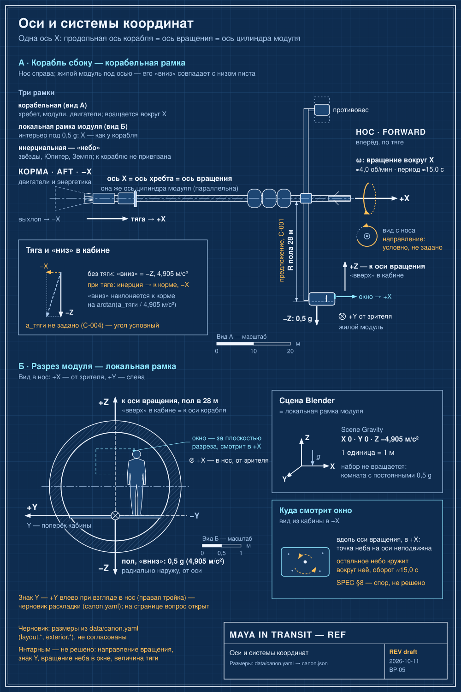

# Соглашения Blender

Кратко: система координат, гравитация сцены, масштаб и структура коллекций для Blender-моделирования корабля и интерьера. Следовать буквально: это часть канона для моделирования.

> [!production] Раздел не развиваем
> Страница переносит соглашения из исходников без развития ([индекс раздела](index.md)).

## Система координат

Рекомендуемая каноническая система ([Ориентация и оси](../30-ship/orientation-and-axes.md)):

*Оси и системы координат (BP-05). Одна ось X на весь корабль: +X — нос и направление тяги, вокруг X вращается корабль. В жилом модуле +Z — к оси вращения, −Z — пол, Y — поперёк кабины. Так же устроена сцена Blender. Янтарным — не решено: направление вращения, знак Y, вращение неба в окне, величина тяги.*

- `+X` — вперёд, направление основной тяги; `−X` — корма;
- `+Z` (локально для жилого модуля) — внутрь, к оси вращения корабля; `−Z` — пол, «низ» искусственной гравитации;
- `Y` — влево и вправо поперёк кабины.

## Гравитация сцены

Для обычных интерьерных кадров — `Scene Gravity: Z = -4.905 m/s²`.

Интерьерный набор сам не вращается. Вращающаяся система отсчёта приближается обычной комнатой с 0,5 g для рутинных производственных кадров ([конвейер](production-pipeline.md), [искусственная гравитация](../30-ship/artificial-gravity.md)).

## Масштаб

Рабочий масштаб: **1 единица Blender = 1 метр**.

## Структура коллекций

Корневая коллекция `SHIP`, внутри четыре группы:

- **снаружи:** `EXT_SPINE`, `EXT_HAB_POD`, `EXT_SERVICE_POD`, `EXT_BOOMS`, `EXT_PROPULSION`, `EXT_RADIATORS`, `EXT_ANTENNAS`, `EXT_CAMERAS`;
- **интерьер:** `INT_HAB_SHELL`, `INT_STRUCTURE`, `INT_WORKSTATION`, `INT_GALLEY`, `INT_HYGIENE`, `INT_STASIS`, `INT_ECLSS`, `INT_STORAGE`, `INT_MEDICAL`, `INT_EXERCISE`, `INT_LIGHTING`;
- **реквизит и персонаж:** `PROPS_STATIC`, `PROPS_RIGIDBODY`, `CHARACTER_MAYA`, `CHARACTER_CLOTH`, `CHARACTER_HAIR`;
- **камеры:** `CAMERA_A_VLOG`, `CAMERA_B_WIDE`, `CAMERA_C_CLOSE`, `CAMERA_EXTERNAL`.

### Коллекции и страницы вики

| Коллекция | Страница вики |
|---|---|
| EXT_SPINE | [Центральный хребет](../30-ship/exterior/central-spine.md) |
| EXT_HAB_POD | [Жилой модуль снаружи](../30-ship/exterior/habitat-pod-exterior.md) |
| EXT_SERVICE_POD | [Служебный модуль-противовес](../30-ship/exterior/service-pod.md) |
| EXT_BOOMS | [Радиальные фермы](../30-ship/exterior/booms.md) |
| EXT_PROPULSION | [Двигательная установка и баки](../30-ship/exterior/propulsion.md), [Реактор и энергетика](../30-ship/exterior/power-reactor.md) |
| EXT_RADIATORS | [Радиаторы](../30-ship/exterior/radiators.md) |
| EXT_ANTENNAS | [Антенны, датчики, наружные камеры](../30-ship/exterior/antennas-and-sensors.md) |
| EXT_CAMERAS | [Антенны, датчики, наружные камеры](../30-ship/exterior/antennas-and-sensors.md) |
| INT_HAB_SHELL | [Гермокорпус](../30-ship/habitat/pressure-vessel.md) |
| INT_STRUCTURE | [Материалы и маркировка](../30-ship/habitat/materials-and-markings.md) |
| INT_WORKSTATION | [Рабочее место](../30-ship/habitat/command-station.md) |
| INT_GALLEY | [Камбуз](../30-ship/habitat/galley.md) |
| INT_HYGIENE | [Санузел](../30-ship/habitat/hygiene.md) |
| INT_STASIS | [Отсек стазиса, сна и укрытия](../30-ship/habitat/stasis-shelter.md) |
| INT_ECLSS | [Сервисная стена СЖО](../30-ship/habitat/service-wall.md) |
| INT_STORAGE | [Хранение](../30-ship/habitat/storage.md) |
| INT_MEDICAL | [Медицинский шкаф](../30-ship/habitat/medical.md) |
| INT_EXERCISE | [Тренажёры](../30-ship/habitat/exercise.md) |
| INT_LIGHTING | [Освещение](../30-ship/habitat/lighting.md) |
| PROPS_STATIC, PROPS_RIGIDBODY | [Личные вещи и реквизит](../30-ship/habitat/personal-items.md) |
| CHARACTER_MAYA, CHARACTER_CLOTH, CHARACTER_HAIR | [Майя](../40-characters/maya.md), [Одежда Майи](../40-characters/maya-wardrobe.md) |
| CAMERA_A_VLOG, CAMERA_B_WIDE, CAMERA_C_CLOSE | [Камеры](cameras.md), [Внутренние камеры](../30-ship/habitat/interior-cameras.md) |
| CAMERA_EXTERNAL | [Антенны, датчики, наружные камеры](../30-ship/exterior/antennas-and-sensors.md) |

Соответствие коллекций страницам — вывод по именам, а не указание исходников.

## Связи
- [Ориентация и оси](../30-ship/orientation-and-axes.md) — полное описание системы координат корабля
- [Конвейер производства](production-pipeline.md) — физика и фазы работы
- [Минимальный набор ассетов](asset-list.md) — что лежит в коллекциях
- [Корабль](../30-ship/index.md) — обзор корабля
- [Чек-лист заморозки](../90-reference/freeze-checklist.md) — что должно быть задано до Blender

## Основания
> [!production] Решение для производства
> Единая система координат, масштаб 1 единица = 1 метр и фиксированная структура коллекций нужны, чтобы работа нескольких исполнителей оставалась согласованной и чтобы вики и Blender-файл ссылались на одни и те же имена.

## Открытые вопросы
- Нужна ли отдельная коллекция для экранных шаблонов и вида Юпитера/Европы (исходник их не включает, а рендер использует замены экранов и предрендеренные виды).
