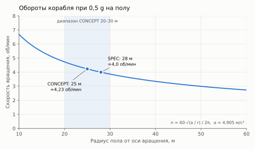

# Чертежи

Кратко: все чертежи и схемы вики на одной странице. Чертежи рисует код из канонических чисел и подписей, поэтому они не расходятся с текстом. Стоит поменять число в каноне — чертёж пересобирается, и новая версия сразу видна в Obsidian и на сайте. Это синьки-черновики: они фиксируют облик для моделирования, а не инженерную точность ([D-007](decisions.md)).

## Как они обновляются

- **Откуда берутся числа.** Размеры — из `data/canon.yaml`, производные величины считает `calc/derive.py`, подписи на русском и английском — из `data/strings.yaml`, геометрия листов — в `figures/blueprints/`. Руками в чертёж не вписывается ни одно число.
- **Как пересобрать.** `uv run tools/build.py` пересчитывает производные, обновляет числа в тексте страниц, перерисовывает все листы и графики и проверяет вики. С ключом `--watch` то же самое происходит при каждом сохранении этих файлов.
- **Почему видно сразу.** Страницы вставляют файлы SVG по ссылке, поэтому Obsidian и сайт всегда показывают последнюю версию. Сайт при публикации пересобирает чертежи сам.
- **Логические схемы** (кто кому подчиняется, путь ролика до зрителя, контуры жизнеобеспечения) написаны на Mermaid прямо в тексте страниц: правишь текст — меняется схема (список в конце страницы).

## Корабль целиком

### BP-01 — корабль сбоку

*Нос справа, корма слева, ось вращения идёт по хребту. Жилой модуль висит на ферме под осью, противовес — напротив, на той же станции. Вдоль хребта от кормы: двигатели, реактор с теневой защитой, радиаторы, баки, ступица с ядром ARI, носовая мачта связи. Деталь A — ступица: ядро ARI, ручной рубильник, жёсткая линия ARI ISOLATE.*

На страницах: [Корабль](../30-ship/index.md), [Общая архитектура](../30-ship/ship-architecture.md), [Центральный хребет](../30-ship/exterior/central-spine.md), [Радиальные фермы](../30-ship/exterior/booms.md), [Жилой модуль снаружи](../30-ship/exterior/habitat-pod-exterior.md), [ARI в корабле](../30-ship/systems/ari-interfaces.md).

### График — обороты и радиус

*Сколько оборотов в минуту нужно для 0,5 g на полу при разном радиусе; точка — канон SPEC.*

На странице: [Искусственная гравитация](../30-ship/artificial-gravity.md).

## Жилой модуль

### BP-02 — план

*От носа к корме: окно, главная кабина с рабочим местом, камбуз и хранение, санузел и отсек стазиса по сторонам прохода, сервисная стена, люк к ферме (пунктир — вариант люка в «потолке», C-003). Камеры A/B/C показаны с конусами обзора.*

На страницах: [Жилой модуль](../30-ship/habitat/index.md), [Планировка](../30-ship/habitat/interior-layout.md), [Рабочее место](../30-ship/habitat/command-station.md), [Внутренние камеры](../30-ship/habitat/interior-cameras.md) и страницы отдельных зон.

### BP-03 — поперечный разрез

*Разрез через главную кабину: гермо- и защитная оболочки, пол ниже оси цилиндра, подпольные баки воды, шкафы, высота потолка, Майя в рост. «Вниз» — радиально наружу, «вверх» — к оси вращения.*

На страницах: [Гермокорпус](../30-ship/habitat/pressure-vessel.md), [Жилой модуль](../30-ship/habitat/index.md), [Вода](../30-ship/systems/water.md), [Радиационная защита](../30-ship/systems/radiation-protection.md).

### BP-04 — продольный разрез

*Окно в носу, зоны и высоты по длине, подпольные баки воды, тамбур и люк к ферме с вариантом C-003, жёсткая линия ARI ISOLATE к ферме.*

На страницах: [Планировка](../30-ship/habitat/interior-layout.md), [Жилой модуль снаружи](../30-ship/exterior/habitat-pod-exterior.md), [Обзорное окно](../30-ship/habitat/observation-window.md), [Отсек стазиса](../30-ship/habitat/stasis-shelter.md).

## Логические схемы (Mermaid)

- [Организации](../10-world/organizations.md) — кто заказал, построил и ведёт миссию, кто на борту.
- [Медиа и зрители](../10-world/media-and-audience.md) — путь ролика от камеры до публикации.
- [Жизнеобеспечение](../30-ship/systems/life-support.md) — контуры воздуха, кислорода, воды и отходов.
- [Конвейер производства](../70-series/production-pipeline.md) — от идеи до рендера.

## Что ещё будет

Изометрические виды навыком anatomy (жилой модуль в разрезе, рабочее место, корабль целиком) и разнесённый вид — в [плане чертежей](figures-roadmap.md).

## Связи
- [План чертежей и диаграмм](figures-roadmap.md) — что ещё рисуем и чем
- [Библиотека промптов](diagram-prompts.md) — исходные задания на чертежи
- [Канонические значения](canon-values.md) — числа, из которых собраны листы
- [Противоречия](contradictions.md) — C-001 (радиус) и C-003 (люк к ферме) видны на листах как варианты
- [Журнал решений](decisions.md) — D-006 и D-007: откуда графика и зачем она

## Основания
> [!production] Решение для производства
> Чертёж обязывает: при моделировании ему следуют строго, а отступление оформляется решением в журнале ([D-007](decisions.md)). Пока страницы корабля в статусе `draft`, листы тоже черновые — штамп «REV draft» на каждом.

## Открытые вопросы
- Радиус пола 28 или 25 м ([C-001](contradictions.md)): от него зависят все листы корабля.
- Люк к ферме: кормовой торец с коленом или «потолок» ([C-003](contradictions.md)).
